# Báo cáo nghiên cứu: Mật mã cổ điển, Hậu lượng tử (PQC) và khả năng hạ phiên bản TLS 1.3 → 1.2

**Tác giả:** `Nguyen Huu Duan`
**Ngày:** 09/11/2026
**Phạm vi:** Phần 1 (lý thuyết), Phần 2 (câu hỏi nghiên cứu về hạ phiên bản TLS), Phần 3 (nhật ký dựng và chạy lab).
**Môi trường thực nghiệm:** Ubuntu 26.04 LTS trên WSL2, OpenSSL 3.5.5, Go 1.26.8, Python 3.14.4 — chi tiết ở [Phần 3](#phần-3--thực-hiện-và-trình-diễn-lab).

> **Quy ước trình bày.** Mỗi nhận định quan trọng đều kèm trích dẫn tới RFC/FIPS/SP hoặc công trình gốc ngay trong đoạn; danh mục đầy đủ ở [Tài liệu tham khảo](#tài-liệu-tham-khảo). Số liệu hiệu năng trong báo cáo là **đo thực tế** trên một máy thử nghiệm (ghi rõ CPU), không phải ước lượng.

## Mục lục

- [Tóm tắt kết quả (Executive Summary)](#tóm-tắt-kết-quả-executive-summary)
- [Phần 1 – Lý thuyết](#phần-1--lý-thuyết)
  - [1.1. Thuật toán mật mã cổ điển](#11-thuật-toán-mật-mã-cổ-điển)
  - [1.2. Mật mã hậu lượng tử (PQC) theo NIST](#12-mật-mã-hậu-lượng-tử-pqc-theo-nist)
  - [1.3. Giao thức TLS 1.2 (RFC 5246)](#13-giao-thức-tls-12-rfc-5246)
  - [1.4. Giao thức TLS 1.3 (RFC 8446)](#14-giao-thức-tls-13-rfc-8446)
  - [1.5. Thư viện mật mã và TLS](#15-thư-viện-mật-mã-và-tls)
- [Phần 2 – Câu hỏi nghiên cứu: có thể ép TLS 1.3 xuống TLS 1.2 không?](#phần-2--câu-hỏi-nghiên-cứu-có-thể-ép-tls-13-xuống-tls-12-không)
- [Phần 3 – Laboratory](#phần-3--laboratory)
- [Phụ lục A – Tham số kỹ thuật các tiêu chuẩn](#phụ-lục-a--tham-số-kỹ-thuật-các-tiêu-chuẩn)
- [Tài liệu tham khảo](#tài-liệu-tham-khảo)

---

## Tóm tắt kết quả (Executive Summary)

Báo cáo trả lời câu hỏi thực hành: *khi client và server đều hỗ trợ cả TLS 1.2 và TLS 1.3, một kẻ tấn công đứng giữa (MITM) có thể ép hai bên thương lượng xuống TLS 1.2 không?*

**Câu trả lời: KHÔNG** — với điều kiện cả hai bên được cấu hình đúng chuẩn và client xác thực chứng chỉ server nghiêm ngặt. Cơ chế chống hạ phiên bản của TLS 1.3 (RFC 8446) và việc chữ ký của server phủ lên `server_random` khiến mọi can thiệp vào quá trình thương lượng đều bị client phát hiện và hủy kết nối. Kẻ tấn công chỉ có thể gây **gián đoạn (DoS)**, không thể hạ phiên bản thành công.

Kết luận này được **chứng minh bằng lab** (Phần 3): kịch bản tấn công **S2** — MITM xóa thông tin "hỗ trợ TLS 1.3" khỏi ClientHello — kết thúc bằng việc client OpenSSL hủy kết nối với lỗi `inappropriate fallback`; đồng thời bắt được tận mắt cờ cảnh báo `DOWNGRD\x01` trong gói ServerHello (kịch bản **S2b**).

**Kết luận đảo thành CÓ** chỉ khi xuất hiện một điều kiện **ngoài chuẩn**, và lab cũng tái hiện được: client tự "fallback" xuống 1.2 mà không gửi `TLS_FALLBACK_SCSV` (**S5** — hạ cấp thành công), hoặc client **không xác thực chứng chỉ** nên chấp nhận server giả của MITM (**S6**). Mỗi điều kiện đều kèm biện pháp phòng chống cụ thể cho cả client và server (mục [2.4](#24-điều-kiện-làm-đổi-kết-luận-và-biện-pháp-phòng-chống)).

---

## Phần 1 – Lý thuyết

### 1.1. Thuật toán mật mã cổ điển

Hạ tầng bảo mật truyền thông hiện nay dựa trên ba nhóm thuật toán, mỗi nhóm giải một bài toán khác nhau trong một phiên TLS: **mã hóa đối xứng** bảo vệ dữ liệu ứng dụng, **trao đổi khóa** thiết lập bí mật chung, và **chữ ký số** xác thực danh tính. Mục này trình bày nguyên lý, tham số thường dùng, điểm mạnh/yếu của từng nhóm, rồi phân tích tác động của máy tính lượng tử.

#### 1.1.1. Mã hóa đối xứng – AES

AES (Advanced Encryption Standard) được chuẩn hóa trong **FIPS 197** (2001, bản cập nhật 2023). Đây là mã khối **đối xứng** (dùng cùng một khóa để mã hóa và giải mã), xử lý khối dữ liệu cố định **128 bit** theo kiến trúc **mạng thay thế–hoán vị (SPN — Substitution–Permutation Network)**.

##### a) Mô hình tổng quát

AES không mã hóa cả bản rõ một lần, mà **lặp nhiều vòng (round)** biến đổi trên một khối 128 bit. Số vòng phụ thuộc độ dài khóa:

| Độ dài khóa | Số vòng (`Nr`) |
|---|---|
| 128 bit | 10 |
| 192 bit | 12 |
| 256 bit | 14 |

Khối 128 bit được tổ chức thành **ma trận trạng thái (state) 4×4 byte** (16 byte). Trước tiên, thuật toán **mở rộng khóa (Key Expansion)** thành một dãy khóa vòng (round keys). Luồng mã hóa:

1. **AddRoundKey khởi tạo** — XOR state với khóa vòng 0.
2. **`Nr − 1` vòng chính**, mỗi vòng gồm **4 bước** theo đúng thứ tự: `SubBytes → ShiftRows → MixColumns → AddRoundKey`.
3. **Vòng cuối** giống vòng chính nhưng **bỏ `MixColumns`** (để mã hóa và giải mã đối xứng về cấu trúc).

Giải mã chạy các phép **nghịch đảo** (`InvSubBytes`, `InvShiftRows`, `InvMixColumns`) theo thứ tự ngược.

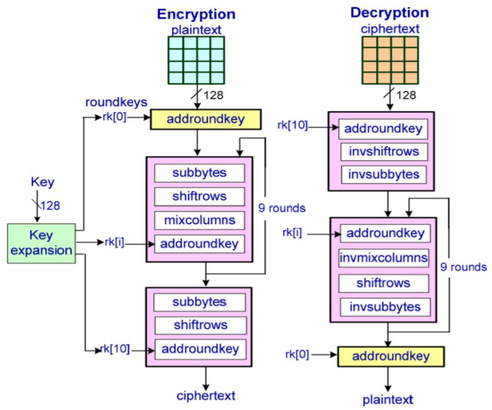


##### b) Bốn bước trong mỗi vòng

Mỗi vòng kết hợp hai nguyên lý của Shannon: **confusion** (làm rối quan hệ khóa–bản mã) qua `SubBytes`, và **diffusion** (khuếch tán ảnh hưởng mỗi bit ra toàn khối) qua `ShiftRows` + `MixColumns`.

**Bước 1 — `SubBytes` (thay thế phi tuyến).** Thay **từng byte** của state bằng một byte khác tra từ **S-box** cố định 256 phần tử. S-box được xây từ nghịch đảo trên trường hữu hạn `GF(2⁸)` cộng một phép biến đổi affine, tạo tính **phi tuyến** — đây là thành phần chống phân tích tuyến tính/vi phân chính của AES.

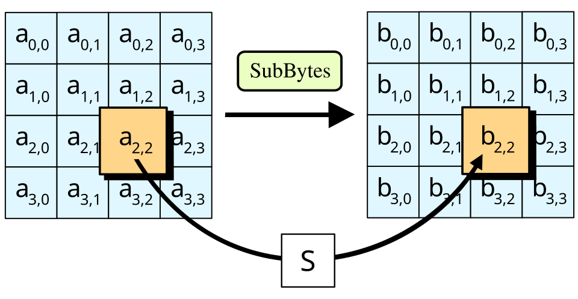

**Bước 2 — `ShiftRows` (dịch hàng).** Hoán vị theo byte: hàng 0 giữ nguyên, hàng 1 dịch trái 1 byte, hàng 2 dịch trái 2 byte, hàng 3 dịch trái 3 byte. Mục đích: trộn các byte giữa các cột để khuếch tán theo chiều ngang.

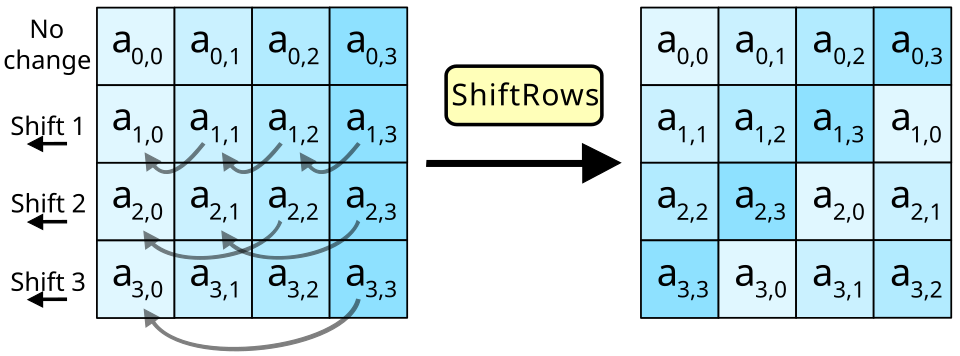

**Bước 3 — `MixColumns` (trộn cột).** Xử lý **từng cột** 4 byte như một đa thức trên `GF(2⁸)` và nhân với một ma trận cố định (hệ số 2, 3, 1, 1). Mỗi byte đầu ra phụ thuộc **cả 4 byte** của cột đầu vào — khuếch tán theo chiều dọc. Kết hợp với `ShiftRows`, chỉ sau vài vòng một bit bản rõ đã ảnh hưởng tới toàn bộ 128 bit (hiệu ứng thác — avalanche). Bước này **bị bỏ ở vòng cuối**.

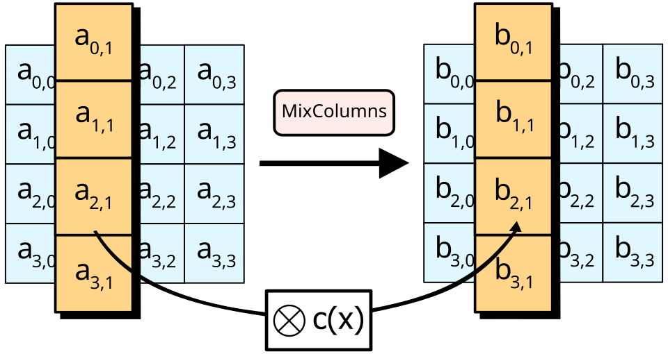

**Bước 4 — `AddRoundKey` (cộng khóa vòng).** XOR toàn bộ state (128 bit) với khóa vòng tương ứng do Key Expansion sinh ra. Đây là bước **duy nhất đưa khóa vào** — không có nó, ba bước trên là công khai và vô nghĩa về bảo mật.

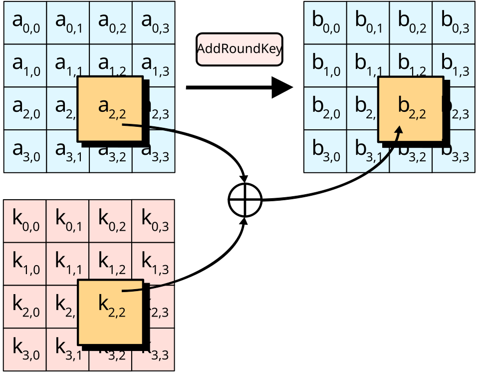 

##### c) Chế độ vận hành (quan trọng hơn thuật toán lõi)

Bản thân AES chỉ biến đổi **một khối 128 bit**; muốn mã hóa dữ liệu dài và an toàn thực tế phải dùng **chế độ vận hành**. Trong TLS hiện đại, AES được dùng ở chế độ **AEAD** (Authenticated Encryption with Associated Data) — vừa **bảo mật** vừa **xác thực toàn vẹn** trong một bước: AES-GCM (NIST SP 800-38D) và AES-CCM (RFC 6655, khuyến nghị trong RFC 8446). Các chế độ cũ như AES-CBC ghép HMAC ("MAC-then-Encrypt") đã bị **loại khỏi TLS 1.3**.

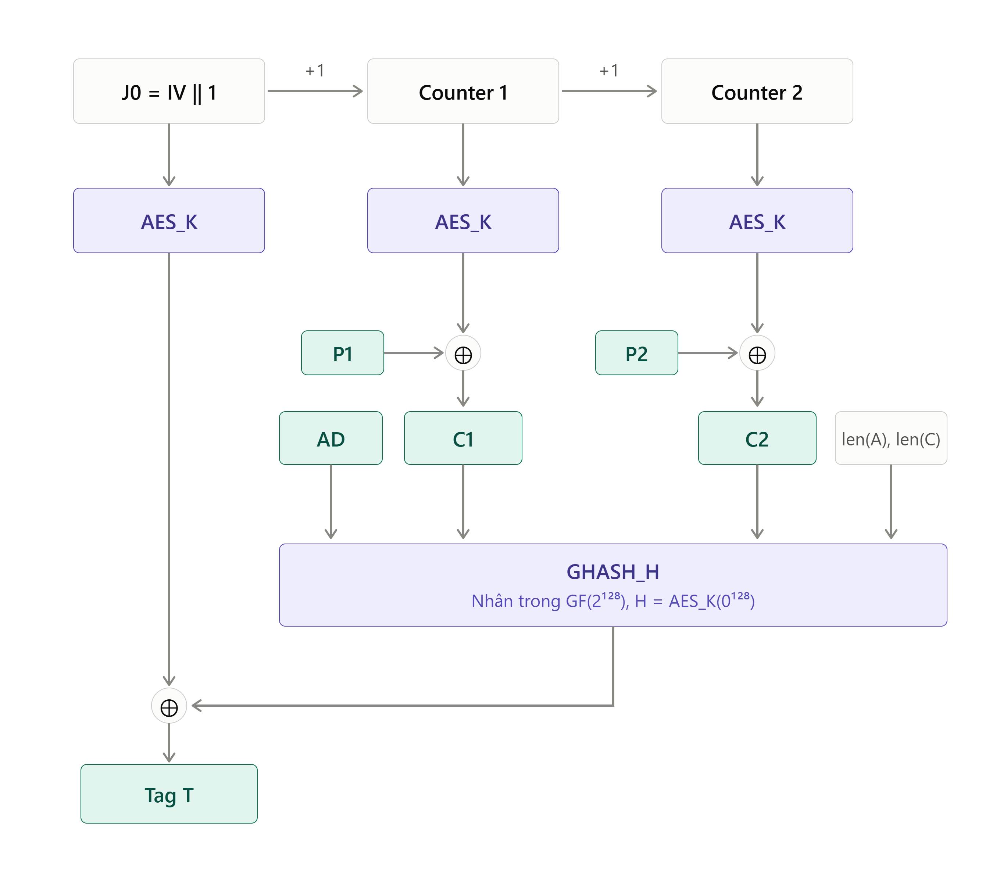
>                   Sơ đồ AES-GCM

**Điểm mạnh:** AES rất nhanh nhờ lệnh phần cứng chuyên dụng (AES-NI trên x86, Crypto Extensions trên ARMv8), đã được phân tích công khai hơn 25 năm mà chưa có tấn công thực tế nào tốt hơn vét cạn một cách đáng kể.

**Điểm yếu** nằm ở chế độ và cài đặt, không ở thuật toán lõi: (1) GCM **sụp đổ nếu tái sử dụng nonce** với cùng khóa — lộ khóa xác thực GHASH và cho phép XOR khôi phục bản rõ; (2) các chế độ CBC từng bị padding oracle (POODLE 2014, Lucky Thirteen 2013); (3) cài đặt dùng bảng tra (T-table) dễ bị tấn công kênh kề cache-timing; (4) có giới hạn lượng dữ liệu an toàn với một khóa, nên TLS 1.3 quy định ngưỡng thay khóa (RFC 8446).

#### 1.1.2. Trao đổi khóa – RSA, DH/ECDH

Nhóm này thiết lập một bí mật chung (pre-master secret) để dẫn xuất khóa phiên. Có ba cách tiếp cận, khác nhau ở **nguyên lý** dưới đây.

**Nguyên lý 1 — RSA key transport (chuyển khóa).** Đây là cơ chế "vận chuyển" chứ không phải "thỏa thuận": một bên tự chọn bí mật rồi gửi an toàn cho bên kia.

- Server có cặp khóa RSA `(n, e)` công khai và `d` bí mật (RFC 8017). Khóa công khai nằm trong chứng chỉ server.
- Client tự sinh `pre_master_secret` 48 byte (RFC 5246), rồi mã hóa: `c = pre_master_secret^e mod n`, gửi `c` cho server.
- Server giải mã bằng khóa riêng: `pre_master_secret = c^d mod n`. Hai bên giờ cùng biết bí mật.
- An toàn dựa trên **bài toán phân tích thừa số `n = p·q`**: không có `d`, kẻ nghe lén không giải được `c`.
- **Hệ quả:** khóa riêng server vừa dùng để xác thực vừa dùng để mở bí mật phiên ⇒ **không có forward secrecy**.

**Nguyên lý 2 — Diffie–Hellman hữu hạn (FFDHE).** Đây là "thỏa thuận": hai bên cùng tạo ra bí mật chung mà không ai gửi nó qua đường truyền.

- Công khai một nhóm: số nguyên tố lớn `p` và phần tử sinh `g` (RFC 7919).
- Mỗi bên chọn số bí mật riêng: client `a`, server `b`. Trao cho nhau `A = g^a mod p` và `B = g^b mod p`.
- Hai bên tự tính cùng một giá trị: client `B^a = g^{ba}`, server `A^b = g^{ab}` ⇒ bí mật chung `g^{ab} mod p`.
- Kẻ nghe lén thấy `g`, `p`, `A`, `B` nhưng muốn tính `g^{ab}` phải giải **logarit rời rạc** (tìm `a` từ `A`) — bài toán khó.
- Nếu `a`, `b` là khóa **tạm thời** (ephemeral, gọi là **DHE**) và bị hủy sau phiên ⇒ **có forward secrecy**.

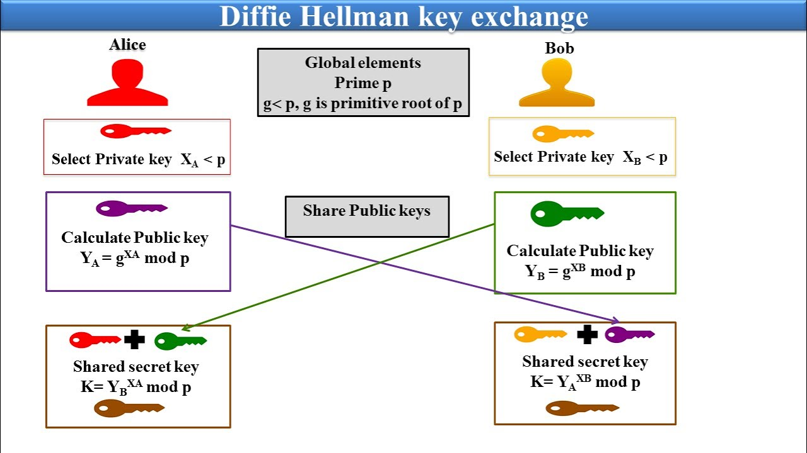

**Nguyên lý 3 — ECDH (Diffie–Hellman trên đường cong elliptic).** Giống hệt DH về ý tưởng, chỉ đổi "sân chơi" toán học từ số mũ modulo `p` sang **phép nhân điểm trên đường cong elliptic**.

- Công khai đường cong và điểm sinh `G`. Mỗi bên chọn số bí mật (`a`, `b`); trao điểm công khai `A = a·G`, `B = b·G` (phép "nhân điểm").
- Bí mật chung: client tính `a·B`, server tính `b·A`, cả hai bằng `a·b·G`.
- An toàn dựa trên **logarit rời rạc trên đường cong elliptic** — khó hơn nhiều so với trường số nguyên cùng kích thước, nên khóa ngắn hơn (256 bit ECC ≈ 3072 bit DH/RSA, xem bảng mức an toàn bên dưới).
- Biến thể tạm thời **ECDHE** (dùng khóa dùng-một-lần) cho forward secrecy; **X25519** (RFC 7748) dùng đường cong Curve25519, chọn tham số để chỉ cần tọa độ `u` + Montgomery ladder nên chạy hằng thời gian và không phải kiểm tra điểm hợp lệ (twist-secure) ⇒ khó cài đặt sai. Đây là cách trao đổi khóa chủ đạo của TLS hiện đại.

Lưu ý chung: **bản thân DH/ECDH không tự xác thực** — hai bên không biết mình đang thỏa thuận với ai. Vì vậy trong TLS, server phải **ký** các tham số trao đổi khóa bằng khóa trong chứng chỉ (ví dụ như ServerKeyExchange ở TLS 1.2), nếu không sẽ bị MITM. Ngược lại RSA key transport ẩn chứa xác thực sẵn (chỉ server có `d` mới mở được bí mật).

So sánh tổng hợp ba cách:

| | RSA key transport | DH hữu hạn (FFDHE) | ECDH (P-256, X25519) |
|---|---|---|---|
| Tiêu chuẩn | RFC 8017 (PKCS #1 v2.2) | RFC 7919, SP 800-56A Rev. 3 | SP 800-56A Rev. 3, RFC 7748 |
| Bài toán khó | Phân tích thừa số `n = p·q` | Logarit rời rạc trên `Z*p` | Logarit rời rạc trên đường cong elliptic |
| Kích thước thường dùng | 2048, 3072 bit | 2048, 3072 bit | 256 bit (≈128-bit security), 384 bit |
| Điểm mạnh | Đơn giản, verify nhanh | Forward secrecy khi dùng khóa tạm (DHE) | Khóa/bản tin nhỏ (32–65 B), nhanh, có FS (ECDHE); X25519 khó cài sai |
| Điểm yếu | **Không forward secrecy**; Bleichenbacher (1998) → ROBOT (2017); khóa lớn | Tham số yếu/export (Logjam 2015); chậm hơn ECDH; tấn công nhóm con nhỏ | Tấn công điểm không hợp lệ nếu không kiểm điểm; DH không tự xác thực ⇒ cần chữ ký |

Điểm khác biệt quan trọng nhất là **forward secrecy (FS)**. Với **RSA key transport**, client sinh một pre-master secret rồi mã hóa bằng khóa công khai RSA của server; ai nắm khóa riêng server (kể cả sau này) đều giải mã được **mọi** phiên đã ghi lại. Với **(EC)DHE**, hai bên trao đổi khóa **tạm thời** rồi hủy ngay sau handshake, nên lộ khóa dài hạn về sau không giúp giải mã phiên cũ. Đây là lý do TLS 1.3 **loại bỏ hoàn toàn** RSA key transport và DH tĩnh (RFC 8446).

Về tương quan độ mạnh giữa các nhóm, NIST SP 800-57 Part 1 Rev. 5 (Bảng 2) quy đổi:

| Mức an toàn (bit) | Đối xứng | RSA / DH (modulus) | ECC |
|---|---|---|---|
| 112 | 3DES | 2048 | 224–255 |
| 128 | AES-128 | 3072 | 256–383 |
| 192 | AES-192 | 7680 | 384–511 |
| 256 | AES-256 | 15360 | 512+ |

Bảng này cho thấy ECC đạt cùng mức an toàn với khóa nhỏ hơn RSA rất nhiều (256 bit ECC ≈ 3072 bit RSA) — lý do ECDHE thống trị TLS hiện đại.

#### 1.1.3. Chữ ký số – RSA-PSS, ECDSA, EdDSA

Chữ ký số cho phép bên nhận xác minh **danh tính** người ký và **toàn vẹn** thông điệp, chỉ bằng khóa công khai. Mô hình chung gồm ba thao tác: `KeyGen` (sinh cặp khóa công khai/bí mật), `Sign(sk, m)` (dùng khóa bí mật ký thông điệp `m`), `Verify(pk, m, σ)` (dùng khóa công khai kiểm chữ ký). Trong TLS, server ký để chứng minh nó giữ khóa riêng ứng với chứng chỉ (ServerKeyExchange ở TLS 1.2, CertificateVerify ở TLS 1.3). Dưới đây là **nguyên lý** của ba họ.

**Nguyên lý 1 — RSA-PSS (Probabilistic Signature Scheme).** Theo mô hình "băm rồi ký" (hash-and-sign): không ký trực tiếp thông điệp mà ký một **khối đệm `EM`** được tạo từ hash của thông điệp cộng một salt ngẫu nhiên. Dựa trên cùng bài toán phân tích thừa số như RSA mã hóa, nhưng dùng khóa theo chiều ngược lại — khóa **bí mật** tạo chữ ký, khóa **công khai** kiểm tra (RFC 8017; FIPS 186-5).

- **Thiết lập khóa:** công khai `(n, e)`, bí mật `d`, với `n = p·q`. Gọi `modBits` là độ dài modulus (ví dụ 2048), `emLen` = số byte của `EM`, `hLen` = độ dài hash (ví dụ SHA-256 → 32 byte), `sLen` = độ dài salt (thường đặt bằng `hLen`).

- **Bước 1 — mã hóa EMSA-PSS** (tạo khối `EM` sẽ được ký):
  1. Băm thông điệp: `mHash = Hash(M)` (`hLen` byte).
  2. Sinh **salt ngẫu nhiên** (`sLen` byte) — đây là nguồn của tính "probabilistic".
  3. Ghép `M' = (8 byte 0x00) ‖ mHash ‖ salt` rồi băm lần hai: `H = Hash(M')`.
  4. Tạo khối dữ liệu `DB = PS ‖ 0x01 ‖ salt`, trong đó `PS` là chuỗi byte 0x00 đệm cho đủ độ dài.
  5. Che `DB` bằng mặt nạ sinh từ `H`: `maskedDB = DB ⊕ MGF(H)`. **MGF** là hàm sinh mặt nạ.
  6. Ghép khối cuối: `EM = maskedDB ‖ H ‖ 0xbc`.

- **Bước 2 — ký:** coi `EM` như số nguyên và nâng lũy thừa bằng khóa bí mật: `s = EM^d mod n`. Chữ ký `s` dài bằng modulus (256 byte với RSA-2048).

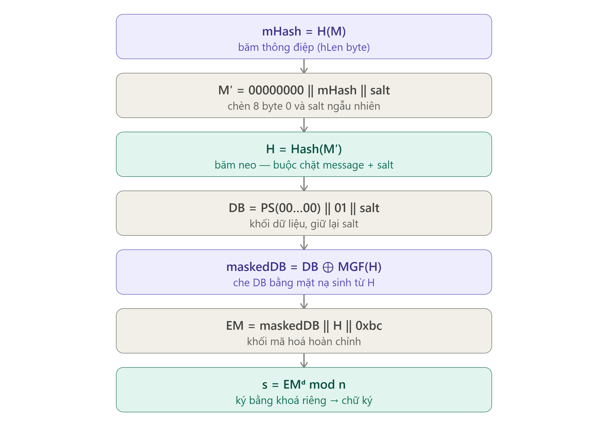


- **Xác minh** (bên nhận có `(n, e)` và `M`):
  1. Khôi phục khối: `EM = s^e mod n`.
  2. Tách `maskedDB`, `H`, và kiểm byte cuối `0xbc`.
  3. Bỏ mặt nạ: `DB = maskedDB ⊕ MGF(H)`, tách ra `salt`.
  4. Tự tính lại `H' = Hash((8 byte 0x00) ‖ Hash(M) ‖ salt)` và so `H' == H`. Khớp ⇒ chữ ký hợp lệ.
  - Chỉ ai có `d` mới tạo được `s` sao cho `EM = s^e` có cấu trúc PSS đúng; salt nằm **trong** khối đã ký nên bên nhận lấy lại được để kiểm, không cần biết trước.

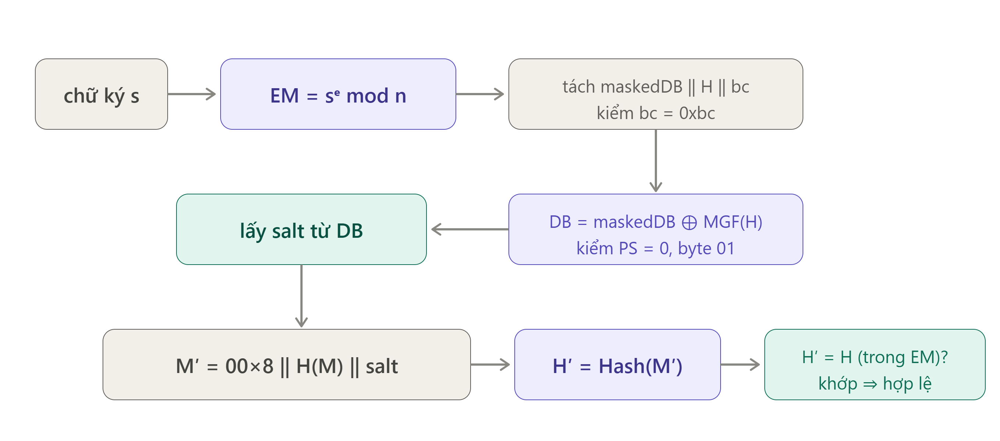

- **Vì sao "probabilistic" và vì sao dùng PSS:** vì mỗi lần ký lại sinh `salt` mới nên **cùng một thông điệp cho ra chữ ký khác nhau** mỗi lần. Khác với padding cũ **PKCS#1 v1.5** (tất định, cấu trúc cứng), PSS có **chứng minh an toàn quy về bài toán RSA** trong mô hình random oracle, chống các lớp tấn công giả mạo mà v1.5 không chặn được. Vì vậy TLS 1.3 **bắt buộc** chữ ký RSA phải là RSA-PSS (RFC 8446).

- **Đặc tính:** verify rất nhanh (mũ công khai `e` nhỏ, thường 65537), nhưng ký chậm (lũy thừa với `d` lớn) và chữ ký lớn (= độ dài modulus, 256 B với RSA-2048).


**Nguyên lý 2 — ECDSA (Elliptic Curve Digital Signature Algorithm).** Biến thể đường cong elliptic của DSA; an toàn dựa trên **logarit rời rạc trên đường cong** (FIPS 186-5; SEC 1).

- Tham số: đường cong, điểm sinh `G` bậc `n`. Khóa bí mật là số `d`; khóa công khai là điểm `Q = d·G`.
- **Ký thông điệp `m`:**
  1. Tính `h = Hash(m)`.
  2. Sinh một **nonce ngẫu nhiên `k`** (bí mật, dùng-một-lần), tính điểm `k·G = (x₁, y₁)`.
  3. `r = x₁ mod n`. Nếu `r = 0`, chọn lại `k`.
  4. `s = k⁻¹ · (h + r·d) mod n`. Chữ ký là cặp `(r, s)`.
- **Xác minh** `(r, s)` với `Q`: tính `u₁ = h·s⁻¹`, `u₂ = r·s⁻¹`, rồi điểm `u₁·G + u₂·Q = (x₁, y₁)`; chữ ký hợp lệ nếu `x₁ mod n = r`.
- **Điểm yếu cốt tử — nonce `k`:** công thức `s = k⁻¹(h + r·d)` chứa cả `k` và khóa bí mật `d`. Nếu `k` **lặp lại** cho hai thông điệp khác nhau, hoặc chỉ bị **lệch/đoán được vài bit**, kẻ tấn công giải ngược ra `d`. Đây chính là nguyên nhân vụ **Sony PlayStation 3 (2010)** dùng `k` cố định làm lộ khóa ký firmware, và nhiều tấn công lattice trên nonce lệch. Do đó ECDSA **phụ thuộc sống còn vào chất lượng RNG** khi ký.
- Đặc tính: chữ ký nhỏ (P-256: 64 B raw), phổ biến trong chứng chỉ web.

**Nguyên lý 3 — EdDSA (Edwards-curve DSA, Ed25519/Ed448).** Lược đồ kiểu **Schnorr** trên đường cong Edwards, thiết kế để tránh đúng điểm yếu nonce của ECDSA (RFC 8032; FIPS 186-5).

- Khóa bí mật là một seed; từ đó dẫn xuất khóa vô hướng và một khóa phụ `prefix`. Khóa công khai `A = s·B` (`B` là điểm sinh).
- **Ký `m`:** điểm mấu chốt là nonce được sinh **tất định (deterministic)**: `r = Hash(prefix ‖ m)` — tức phụ thuộc vào khóa bí mật và chính thông điệp, **không dùng RNG**. Sau đó: điểm `R = r·B`; `S = (r + Hash(R ‖ A ‖ m)·s) mod L`. Chữ ký là `(R, S)`.
- **Xác minh:** kiểm đẳng thức `S·B = R + Hash(R ‖ A ‖ m)·A`.
- Vì `r` sinh tất định nên **không thể vô tình lặp nonce** → loại bỏ hẳn lớp tấn công đã hạ gục ECDSA; cũng **không cần nguồn ngẫu nhiên tốt khi ký**. Thiết kế đường cong Edwards còn cho phép công thức cộng điểm thống nhất, dễ cài đặt **hằng thời gian**, tránh kênh kề.
- Đặc tính: nhanh, chữ ký 64 B, khóa công khai 32 B; nhược điểm là được HSM/chuẩn FIPS hỗ trợ muộn hơn, và chữ ký tất định nhạy hơn với tấn công **chủ động gây lỗi (fault injection)**.

Bảng tổng hợp:

| | RSA-PSS | ECDSA | EdDSA (Ed25519/Ed448) |
|---|---|---|---|
| Tiêu chuẩn | RFC 8017, FIPS 186-5 | FIPS 186-5, SEC 1 | RFC 8032, FIPS 186-5 |
| Bài toán khó | Phân tích thừa số `n = p·q` | Logarit rời rạc trên đường cong | Logarit rời rạc trên đường cong |
| Nonce khi ký | salt ngẫu nhiên (PSS) | **`k` ngẫu nhiên — nhạy cảm** | **tất định** từ khóa + thông điệp |
| Kích thước chữ ký | = modulus (256 B với RSA-2048) | P-256: 64 B (raw), ~70–72 B (DER) | Ed25519: 64 B (khóa công khai 32 B) |
| Điểm mạnh | Verify rất nhanh; tương thích rộng; bắt buộc trong TLS 1.3 | Nhỏ, phổ biến trong chứng chỉ web | Nhanh, tất định, dễ cài hằng thời gian |
| Điểm yếu | Ký chậm, chữ ký lớn | **Lộ khóa nếu nonce lặp/lệch** (Sony PS3 2010); phụ thuộc RNG | HSM/FIPS hỗ trợ muộn hơn; nhạy tấn công fault |

#### 1.1.4. Tác động của máy tính lượng tử

Hai thuật toán lượng tử định hình toàn bộ chủ đề PQC:

- **Thuật toán Shor (1994):** giải bài toán phân tích thừa số **và** logarit rời rạc (kể cả trên đường cong elliptic) trong thời gian **đa thức**. Hệ quả: **RSA, DH, ECDH, ECDSA, EdDSA đều bị phá vỡ hoàn toàn** khi có máy tính lượng tử đủ lớn. Quan trọng: **tăng độ dài khóa không cứu được**, vì chi phí phá chỉ tăng theo đa thức. Ước lượng của Gidney (arXiv:2505.15917, 21/05/2025) cho rằng RSA-2048 có thể bị phá với **dưới 1 triệu qubit vật lý nhiễu** (cụ thể ~897.864 qubit) trong **chưa đầy một tuần** (~4,96 ngày), nhờ số học modulo xấp xỉ, yoked surface code và magic state cultivation. Con số này giảm mạnh so với ước lượng Gidney–Ekerå 2019 (20 triệu qubit, 8 giờ), cho thấy mối đe dọa đang tiến lại gần.
- **Thuật toán Grover (1996):** tăng tốc **bậc hai** cho tìm kiếm vét cạn, làm khóa đối xứng `k` bit chỉ còn tương đương `k/2` bit. Trên thực tế Grover khó song song hóa và cần mạch cực sâu, nên NIST vẫn xếp AES-128 ở mức "category 1". Giải pháp đơn giản: **tăng độ dài khóa** (AES-256, SHA-384/512).

| Nhóm | Thuật toán | Tác động lượng tử | Biện pháp |
|---|---|---|---|
| Đối xứng | AES-128/256 | Grover: suy giảm bậc hai | Dùng AES-256 cho dữ liệu dài hạn — **chỉ cần tăng khóa** |
| Trao đổi khóa | RSA, DH, ECDH | Shor: **bị phá hoàn toàn** | Thay bằng ML-KEM (hybrid trong giai đoạn chuyển tiếp) |
| Chữ ký | RSA-PSS, ECDSA, EdDSA | Shor: **bị phá hoàn toàn** | Thay bằng ML-DSA, SLH-DSA, LMS/XMSS |

**Mối đe dọa "harvest-now, decrypt-later":** kẻ tấn công có thể **ghi lại lưu lượng mã hóa hôm nay** và lưu trữ, chờ đến khi có máy tính lượng tử để giải mã. Vì vậy **trao đổi khóa phải chuyển sang PQC trước tiên** (dữ liệu hôm nay đã có thể bị thu thập), trong khi **chữ ký** chỉ cần an toàn tại thời điểm xác thực nên ít cấp bách hơn — ngoại trừ chữ ký có tuổi thọ dài như firmware hay root CA.

---

### 1.2. Mật mã hậu lượng tử (PQC) theo NIST

#### 1.2.1. Quá trình chuẩn hóa

NIST khởi động chương trình chuẩn hóa PQC công khai từ cuối 2016 (sau báo cáo NISTIR 8105, 04/2016). Diễn tiến chính:

| Thời điểm | Sự kiện |
|---|---|
| 12/2016 | Kêu gọi đề xuất |
| 12/2017 | Vòng 1: 69 ứng viên hợp lệ (trên 82 bài nộp) |
| 01/2019 | Vòng 2: 26 ứng viên (NISTIR 8309) |
| 07/2020 | Vòng 3: 7 finalist + 8 alternate |
| 07/2022 | Chọn CRYSTALS-Kyber (KEM) và CRYSTALS-Dilithium, Falcon, SPHINCS+ (chữ ký). Vòng 4 KEM: BIKE, Classic McEliece, HQC, SIKE — **SIKE bị phá 08/2022** |
| 08/2023 | Công bố bản nháp FIPS 203/204/205 |
| **13/08/2024** | **Ban hành chính thức FIPS 203 (ML-KEM), FIPS 204 (ML-DSA), FIPS 205 (SLH-DSA)** |
| 11/2024 | NIST IR 8547 (draft): lộ trình ngừng RSA/ECC — *deprecated* sau 2030, *disallowed* sau 2035 |
| 03/2025 | Chọn **HQC** làm KEM dự phòng (dựa trên mã sửa lỗi, khác họ lattice); sẽ chuẩn hóa thành **FIPS 207** |
| Đang tiến hành (tính đến 2026) | **FIPS 206** (FN-DSA, từ Falcon): bản nháp công khai **chưa phát hành**, dự kiến hoàn tất ~2027. **FIPS 207** (HQC): bản nháp dự kiến, final ~2027. Ngoài ra có vòng chữ ký bổ sung ("on-ramp") đang xét |

Việc **SIKE bị phá chỉ một tháng sau khi được chọn vào vòng 4** (08/2022) là bài học nền tảng cho chiến lược **hybrid** (mục 1.2.4): không đặt cược toàn bộ vào một giả thiết toán học mới.

Ba tiêu chuẩn đã ban hành:

- **FIPS 203 – ML-KEM** (Module-Lattice-Based Key-Encapsulation Mechanism, từ Kyber): dựa trên bài toán **Module-LWE**. Ba mức ML-KEM-512/768/1024 tương ứng category 1/3/5.
- **FIPS 204 – ML-DSA** (từ Dilithium): chữ ký kiểu "Fiat–Shamir with aborts" trên Module-LWE/SIS. ML-DSA-44/65/87 tương ứng category 2/3/5.
- **FIPS 205 – SLH-DSA** (từ SPHINCS+): chữ ký **dựa trên hàm băm**, không trạng thái. Giả thiết an toàn **chỉ** dựa vào tính một chiều của hàm băm — rất bảo thủ — nhưng đổi lại chữ ký lớn và ký chậm (xem số đo ở 1.2.3). Có biến thể `s` (small, chữ ký nhỏ hơn) và `f` (fast, ký nhanh hơn).

Thang "category" của NIST: 1 ≈ vét cạn khóa AES-128, 3 ≈ AES-192, 5 ≈ AES-256; (2 và 4 tương ứng tìm va chạm SHA-256/SHA-384).

#### 1.2.2. So sánh kích thước với RSA/ECDSA ở mức an toàn tương đương

Đây là điểm đánh đổi lớn nhất của PQC: **an toàn lượng tử đổi lấy kích thước lớn hơn**. Số liệu lấy từ FIPS 203 Bảng 3, FIPS 204 Bảng 2, FIPS 205 Bảng 2.

**KEM / trao đổi khóa:**

| Thuật toán | Mức an toàn | Khóa công khai (byte) | Khóa bí mật (byte) | Bản mã / key share server (byte) | Shared secret (byte) |
|---|---|---|---|---|---|
| X25519 | ~128 bit (cổ điển) | 32 | 32 | 32 | 32 |
| ECDH P-256 | ~128 bit | 65 | 32 | 65 | 32 |
| RSA-2048 (key transport) | 112 bit | 256 | ~1190 (DER) | 256 | 48 |
| RSA-3072 | 128 bit | 384 | ~1770 | 384 | 48 |
| ML-KEM-512 | Cat. 1 | 800 | 1632 | 768 | 32 |
| **ML-KEM-768** | **Cat. 3** | **1184** | **2400** | **1088** | **32** |
| ML-KEM-1024 | Cat. 5 | 1568 | 3168 | 1568 | 32 |

**Chữ ký:**

| Thuật toán | Mức an toàn | Khóa công khai (byte) | Khóa bí mật (byte) | Chữ ký (byte) |
|---|---|---|---|---|
| Ed25519 | ~128 bit | 32 | 32 | 64 |
| ECDSA P-256 | ~128 bit | 64–65 | 32 | 64 (raw) / ~72 (DER) |
| RSA-2048 (PSS) | 112 bit | 256 | ~1190 | 256 |
| **ML-DSA-65** | **Cat. 3** | **1952** | **4032** | **3309** |
| ML-DSA-87 | Cat. 5 | 2592 | 4896 | 4627 |
| SLH-DSA-SHA2-128s | Cat. 1 | 32 | 64 | 7856 |
| SLH-DSA-SHA2-128f | Cat. 1 | 32 | 64 | 17088 |
| SLH-DSA-SHA2-256s | Cat. 5 | 64 | 128 | 29792 |


**Kết luận (kích thước PQC — cho cả hai bảng).** Điểm chung của cả KEM lẫn chữ ký là PQC đổi an toàn lượng tử lấy **kích thước lớn hơn nhiều lần**, chứ không phải tốc độ. Ở **KEM**, khóa công khai và bản mã ML-KEM-768 lớn hơn X25519 khoảng **35–50 lần** (1184/1088 byte so với 32/32 byte), nhưng **shared secret vẫn chỉ 32 byte** — khóa phiên AES không hề to ra, nên gánh nặng nằm trọn ở dữ liệu handshake. Ở **chữ ký**, đánh đổi còn gay gắt hơn: ML-DSA-65 (3309 byte) gấp ~13 lần RSA-2048 và ~50 lần Ed25519, SLH-DSA còn lớn hơn (≥ 7856 byte); mà một handshake lại mang **nhiều** chữ ký và khóa cùng lúc (chứng chỉ server, chuỗi CA, CertificateVerify), nên tổng chi phí có thể tăng **hàng chục KB** mỗi kết nối, vượt cửa sổ tắc nghẽn TCP ban đầu và thêm RTT. Ba hệ quả thực tế: (1) PQC cho **trao đổi khóa** (ML-KEM) đáng triển khai trước vì vừa cấp bách (chống harvest-now-decrypt-later) vừa nhẹ hơn và dẫn tới cơ chế **hybrid** (mục 1.2.4); (2) PQC cho **chữ ký** nặng hơn, ít cấp bách hơn, nên lộ trình chuyển đổi chứng chỉ sẽ chậm hơn; (3) **SLH-DSA** tuy lớn và chậm nhất lại là lựa chọn bảo thủ nhất (chỉ dựa vào hàm băm), dành cho chữ ký dài hạn, ký hiếm như firmware hoặc chứng chỉ gốc.

#### 1.2.3. So sánh hiệu năng (đo thực tế)

Số liệu dưới đây được **đo bằng `openssl speed`** trên **CPU 11th Gen Intel Core i7-11800H @ 2.30 GHz**, OpenSSL 3.5.5, một lõi, mỗi phép đo 1 giây. Giá trị là **số thao tác mỗi giây** (cao hơn = nhanh hơn):

| Thuật toán | keygen/s | sign hoặc encaps /s | verify hoặc decaps /s | Độ trễ mỗi lần ký/encaps |
|---|---|---|---|---|
| RSA-2048 | (chậm, không đo) | 4 333 (sign) | 74 069 (verify) | ~0,231 ms |
| ECDSA P-256 | — | 56 374 (sign) | 18 790 (verify) | ~17,7 µs |
| Ed25519 | — | 32 091 (sign) | 11 456 (verify) | ~31 µs |
| X25519 (ECDH) | — | 37 624 (op/s) | — | ~26,6 µs |
| **ML-KEM-768** | 26 865 | 41 984 (encaps) | 26 807 (decaps) | ~24 µs (encaps) |
| **ML-DSA-65** | 6 542 | 1 271 (sign) | 6 418 (verify) | ~787 µs (sign) |
| SLH-DSA-SHA2-128s | 22,8 | 3,1 (sign) | 3 623 (verify) | **~318 ms (sign)** |

Phân tích:

- **ML-KEM-768 nhanh ngang hoặc hơn ECDH cổ điển.** Encaps 41 984/s còn nhanh hơn một phép X25519 (37 624/s). Vậy chi phí thực của ML-KEM **không phải tốc độ mà là băng thông** (key share ~1,1 KB mỗi chiều so với 32 B của X25519).
- **ML-DSA-65 chậm hơn RSA và ECDSA ở cả hai chiều:** ký 1 271/s (so với RSA 4 333/s, ECDSA 56 374/s) và verify 6 418/s (so với ECDSA 18 790/s, RSA 74 069/s). Nguyên nhân chủ yếu là ECC/RSA trong OpenSSL đã được tối ưu assembly hàng chục năm, còn ML-DSA là cài đặt mới hơn. Dù vậy con số tuyệt đối vẫn hàng nghìn thao tác/giây — đủ nhanh cho TLS; đổi lại chữ ký lớn gấp ~13 lần RSA-2048.
- **SLH-DSA-SHA2-128s cực chậm khi ký** — chỉ **~3 chữ ký/giây** (318 ms/chữ ký) — nên chỉ hợp cho các tác vụ ký hiếm, giá trị cao như ký firmware hay chứng chỉ gốc, nơi giả thiết an toàn bảo thủ (chỉ dựa vào hàm băm) là ưu tiên hàng đầu.

**Kết luận (hiệu năng).** Với **trao đổi khóa**, PQC không phải rào cản về tốc độ: ML-KEM còn nhanh hơn ECDH (encaps 41 984/s so với X25519 37 624/s). Với **chữ ký**, ML-DSA trong lần đo này lại chậm hơn RSA/ECDSA ở cả ký lẫn verify — phần lớn vì cài đặt ECC/RSA trong OpenSSL đã được tối ưu lâu năm — nhưng vẫn ở mức hàng nghìn thao tác/giây, đủ nhanh cho TLS. Ngoại lệ thực sự chậm là **SLH-DSA** khi ký (~3 chữ ký/giây), đổi tốc độ lấy mức an toàn bảo thủ nhất. Tổng quát, rào cản lớn nhất của PQC vẫn là **kích thước/băng thông** (mục 1.2.2) chứ không phải CPU; riêng với chữ ký thì nên cân nhắc thêm tốc độ ký của cài đặt cụ thể.

##### Số liệu tham chiếu công khai (cycle counts chính thức)

Vì số đo ở trên chỉ từ **một máy** (OpenSSL 3.5.5, i7-11800H) nên mang tính chủ quan. Để đối chứng khách quan, bảng dưới trích **nguyên văn** cycle counts từ **đặc tả chính thức của nhóm tác giả thuật toán (pq-crystals, vòng 3)** — nguồn uy tín nhất cho hiệu năng Kyber/Dilithium. **Đơn vị là chu kỳ CPU (cycles), thấp hơn = nhanh hơn.**

**ML-KEM (Kyber) — bản AVX2, đo trên Intel Haswell** *(nguồn: đặc tả CRYSTALS-Kyber vòng 3, Bảng "Performance on Intel Haswell CPUs")*:

| Thuật toán | keygen (cycles) | encaps (cycles) | decaps (cycles) |
|---|---|---|---|
| ML-KEM-512 | 33 856 | 45 200 | 34 572 |
| **ML-KEM-768** | **52 732** | **67 624** | **53 156** |
| ML-KEM-1024 | 73 544 | 97 324 | 79 128 |

**ML-DSA (Dilithium) — bản AVX2, đo trên Intel Skylake** (trung vị của 1000 lần chạy, thông điệp 32 byte) *(nguồn: đặc tả CRYSTALS-Dilithium vòng 3, Bảng 1)*:

| Thuật toán | keygen (cycles) | sign — trung vị (cycles) | verify (cycles) |
|---|---|---|---|
| ML-DSA-44 | 124 031 | 259 172 | 118 412 |
| **ML-DSA-65** | **256 403** | **428 587** | **179 424** |
| ML-DSA-87 | 298 050 | 538 986 | 279 936 |

**Nhận xét từ số liệu chính thức** (khớp với kết quả đo cục bộ ở trên):

- **ML-KEM rất nhẹ:** toàn bộ thao tác ML-KEM-768 chỉ ~52–68 nghìn cycles. Để tham chiếu, một phép X25519 trên cùng lớp CPU Haswell vào khoảng ~160 nghìn cycles (eBACS/SUPERCOP) — tức ML-KEM-768 **nhanh hơn** ECDH, xác nhận KEM hậu lượng tử không phải gánh nặng tốc độ.
- **Ký ML-DSA là thao tác nặng nhất** trong nhóm PQC lattice: ML-DSA-65 ký ~428k cycles, gấp ~6 lần encaps của ML-KEM-768 — đúng với quan sát cục bộ rằng ML-DSA là điểm chậm của chữ ký.
- Hai bảng đo trên **hai vi kiến trúc khác nhau** (Kyber trên Haswell, Dilithium trên Skylake) nên **không nên so từng con số tuyệt đối giữa hai bảng**; mỗi bảng chỉ so nội bộ giữa các mức tham số của cùng một thuật toán.

→ Kết hợp hai nguồn (đo cục bộ + đặc tả chính thức), kết luận về hiệu năng **nhất quán**: ML-KEM nhanh, ML-DSA là điểm nặng của nhánh chữ ký, và rào cản tổng thể của PQC vẫn là **kích thước** (mục 1.2.2) hơn là tốc độ.

#### 1.2.4. Cơ chế hybrid: X25519 + ML-KEM-768

**Vì sao dùng hybrid trong giai đoạn chuyển tiếp.** Hybrid kết hợp một thuật toán cổ điển (X25519) với một thuật toán PQC (ML-KEM-768) sao cho phiên vẫn an toàn **nếu ít nhất một trong hai còn an toàn**. Ba lý do:

1. **Phòng ngừa rủi ro toán học.** ML-KEM còn mới; lịch sử cho thấy ứng viên PQC có thể sụp đổ bất ngờ (SIKE 2022, Rainbow 2022). Nếu ML-KEM về sau bị phát hiện lỗ hổng toán học hoặc lỗi cài đặt (ví dụ nhóm lỗi **KyberSlash** 2023–2024 — rò rỉ thời gian trong một số cài đặt), thành phần X25519 vẫn giữ an toàn cổ điển.
2. **Tuân thủ.** X25519/P-256 đã được chứng nhận rộng rãi; **SP 800-56C Rev. 2** cho phép kết hợp một shared secret đã được phê duyệt với một secret khác để dẫn xuất khóa.
3. **Chống harvest-now-decrypt-later ngay hôm nay**, trong khi vẫn giữ tương thích.

**Cơ chế thực thi từng bước.** Điểm cốt lõi: hai thuật toán chạy **song song và độc lập** trong cùng một lần trao đổi `key_share`, rồi hai bí mật chung được **ghép lại** và đưa vào HKDF. Cụ thể với `X25519MLKEM768`:

```
CLIENT                                                   SERVER
(1) Sinh 2 cặp khóa tạm:
    - X25519: (x_priv, x_pub)
    - ML-KEM: (ek, dk)  ek=encapsulation key, dk=decapsulation key
(2) key_share = ek (1184B) ‖ x_pub (32B)  ──────────►
                                            (3) X25519: sinh (y_priv, y_pub);
                                                ss_X = X25519(y_priv, x_pub)
                                            (4) ML-KEM: (ct, ss_K) = Encaps(ek)
                                                ct = bản mã (1088B), ss_K = bí mật (32B)
                            ◄────────── (5) key_share = ct (1088B) ‖ y_pub (32B)
(6) X25519: ss_X = X25519(x_priv, y_pub)
(7) ML-KEM: ss_K = Decaps(ct, dk)
```

Sau bước (7), **cả hai bên cùng có hai bí mật chung** `ss_K` (từ ML-KEM) và `ss_X` (từ X25519). Hai bên ghép theo thứ tự cố định:

```
shared_secret = ss_K (32B)  ‖  ss_X (32B)     = 64 byte
                └ ML-KEM đặt trước ┘   (phù hợp SP 800-56C: thành phần FIPS nằm đầu)
```

Giá trị 64 byte này được nạp **thay cho (EC)DHE secret** vào `HKDF-Extract` trong key schedule TLS 1.3 (mục 1.4.2), từ đó dẫn xuất mọi khóa phiên như bình thường.

**Vì sao ghép nối (concatenation) lại an toàn.** Bộ kết hợp ở đây chỉ là phép **nối chuỗi**, không phải phép trộn phức tạp — an toàn nhờ **HKDF đứng sau đóng vai hàm trích xuất (extractor)**: chừng nào **ít nhất một** trong `ss_K` hoặc `ss_X` còn **bí mật và khó đoán**, thì đầu ra của HKDF vẫn ngẫu nhiên về mặt tính toán với kẻ tấn công. Do đó:

- Máy tính lượng tử phá được X25519 (`ss_X` lộ) nhưng không phá được ML-KEM ⇒ `ss_K` vẫn an toàn ⇒ phiên an toàn.
- Ngược lại, nếu ML-KEM có lỗ hổng (`ss_K` lộ) nhưng X25519 còn tốt ⇒ `ss_X` cứu phiên.

Chỉ khi **cả hai** cùng bị phá thì phiên mới mất an toàn — xác suất đó rất thấp vì hai thuật toán dựa trên **hai bài toán khó hoàn toàn khác nhau** (đường cong elliptic vs lưới module).

**Tích hợp vào TLS 1.3.** Hai tiêu chuẩn chia vai rõ ràng:

- **RFC 9954** *"Hybrid Key Exchange in TLS 1.3"* (Informational, 07/2026): định nghĩa **khuôn khổ chung** để ghép hai thuật toán trao đổi khóa — cấu trúc `key_share` nối chuỗi, bộ kết hợp bằng concatenation, và nguyên tắc "an toàn nếu ít nhất một thành phần còn an toàn".
- **RFC 10024** *"Post-Quantum Traditional (PQ/T) Hybrid Key Agreement Mechanisms for TLS 1.3"* (Proposed Standard, 08/2026): định nghĩa **các named group cụ thể** và codepoint của chúng, cùng thứ tự ghép bí mật.

Chi tiết (theo RFC 10024, mục 4.3 và mục đăng ký IANA):

- Toàn bộ cơ chế trên được "đóng gói" thành một **named group mới** trong extension `supported_groups` / `key_share`, **không thay đổi cấu trúc handshake** — client/server chỉ thấy nó như một nhóm khóa thông thường, nên triển khai được nhanh.
- Codepoint chính thức (RFC 10024, đăng ký IANA "TLS Supported Groups"): `X25519MLKEM768` = **4588 (`0x11EC`)**, `SecP256r1MLKEM768` = **4587 (`0x11EB`)**, `SecP384r1MLKEM1024` = **4589 (`0x11ED`)**.
- Thứ tự ghép bí mật (RFC 10024 mục 4.3): với `X25519MLKEM768`, `shared_secret = ML-KEM ss ‖ X25519 ss` — **phần ML-KEM đặt trước**, mỗi phần 32 byte, tổng 64 byte (nhất quán với sơ đồ ở trên).
- Kích thước cụ thể: client `key_share` = **1216 B** (ek 1184 ‖ x_pub 32); server `key_share` = **1120 B** (ct 1088 ‖ y_pub 32).
- **Hệ quả vận hành:** ClientHello hybrid vượt ~1,5 KB nên bị chia nhiều gói TCP; một số middlebox/server cũ xử lý sai ("ClientHello split"). Nếu client không gửi key share hybrid mà server ưu tiên nó, phát sinh HelloRetryRequest (thêm 1 RTT).
- **Hiện trạng triển khai:** Chrome 131 và Firefox 132 (cuối 2024) bật mặc định `X25519MLKEM768`; Cloudflare và Google hỗ trợ phía server; **OpenSSL 3.5 và Go 1.24** đưa `X25519MLKEM768` vào danh sách group mặc định.

#### 1.2.5. PQC trên thiết bị nhúng và phần cứng bảo mật

Đưa PQC xuống vi điều khiển và HSM gặp loạt ràng buộc về tài nguyên, băng thông và tuân thủ:

| Khía cạnh | Vấn đề | Ghi chú |
|---|---|---|
| RAM / stack | ML-DSA ký cần vài chục KB stack; ML-KEM vài KB–~10 KB | Có cài đặt tối ưu bộ nhớ (pqm4 cho Cortex-M4), đổi lấy tốc độ |
| Flash / code size | Thêm NTT, Keccak (SHAKE), sampling | Có thể dùng chung Keccak với SHA-3 sẵn có |
| Băng thông | Chứng chỉ ML-DSA-65: pk 1952 + chữ ký 3309 B mỗi cấp; chuỗi 2–3 chứng chỉ + CertificateVerify ⇒ **+10–17 KB** mỗi handshake | Vượt `initcwnd` TCP (~14,6 KB) ⇒ thêm RTT; rất nặng với LoRa, NB-IoT, 6LoWPAN; DTLS phải phân mảnh |
| Kênh kề / lỗi | Cần cài hằng thời gian (bài học KyberSlash); masking chống phân tích công suất; chống fault injection | Chi phí masking cho lattice cao hơn nhiều so với AES |
| RNG | ML-KEM và ML-DSA (chế độ hedged) cần entropy chất lượng | Theo SP 800-90A/B/C |
| **Tuân thủ FIPS 140-3** | Mô-đun phải dùng thuật toán đã được CAVP xác nhận (ACVP đã có test cho ML-KEM/ML-DSA/SLH-DSA); yêu cầu self-test khi khởi động (CAST) và pairwise consistency test khi sinh khóa | SP 800-227 (khuyến nghị dùng KEM); SP 800-208 (LMS/XMSS cho ký firmware) |
| Lộ trình | NSA **CNSA 2.0**: ML-KEM-1024, ML-DSA-87, LMS/XMSS cho firmware; ưu tiên chuyển đổi 2025–2030 | NIST IR 8547: RSA/ECC *disallowed* sau 2035 |
| Hệ sinh thái | **PKCS#11 v3.2** bổ sung cơ chế ML-KEM/ML-DSA; HSM/TPM/secure element cần nâng cấp firmware | Thiết bị đã triển khai không cập nhật được ⇒ cần **crypto-agility** từ khâu thiết kế |

---

### 1.3. Giao thức TLS 1.2 (RFC 5246)

**Kiến trúc.** TLS 1.2 (RFC 5246) chạy trên nền **Record Protocol** — tầng bọc và bảo vệ (mã hóa + xác thực toàn vẹn) mọi bản tin — còn phần thiết lập phiên do **Handshake Protocol** đảm nhiệm. Các mục dưới bám đúng mạch của báo cáo: handshake (nơi thiết lập khóa và thương lượng thuật toán), nối lại phiên, cấu trúc cipher suite, và cuối cùng là các điểm yếu lịch sử — chính là bệ phóng cho thiết kế TLS 1.3.

#### 1.3.1. Luồng handshake đầy đủ (ECDHE_RSA) – 2-RTT

TLS 1.2 chuẩn hóa nhiều kiểu trao đổi khóa, nhưng cấu hình phổ biến và được khuyến nghị nhất trên thực tế là **ECDHE kết hợp xác thực RSA** (họ cipher suite `TLS_ECDHE_RSA_WITH_*`), vì vừa cho forward secrecy vừa dùng lại hạ tầng chứng chỉ RSA sẵn có. Toàn bộ quá trình tốn **2-RTT** trước khi truyền dữ liệu ứng dụng:

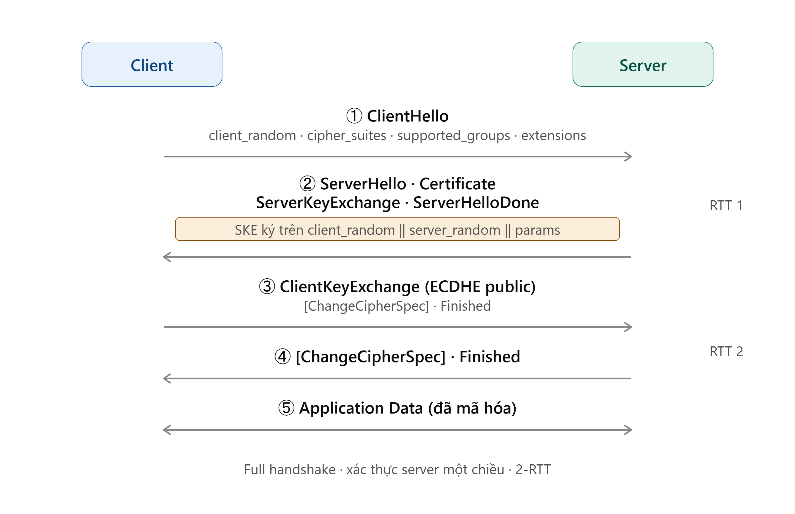

Ảnh trên mô tả **trình tự thông điệp**. Diễn giải chi tiết từng bước:

**① ClientHello (Client → Server).** Client mở phiên, chưa có gì được mã hóa. Client gửi:

- `client_random`: 32 byte ngẫu nhiên (chống phát lại, sau này là đầu vào dẫn xuất khóa).
- `cipher_suites`: danh sách bộ thuật toán client hỗ trợ, ví dụ `TLS_ECDHE_RSA_WITH_AES_256_GCM_SHA384`.
- `supported_groups`: các đường cong/nhóm cho ECDHE (ví dụ `secp256r1`, `x25519`); `signature_algorithms`: các thuật toán chữ ký client chấp nhận cho chứng chỉ và cho ServerKeyExchange.
- Các extension khác: `extended_master_secret`, `session_ticket`, SNI…

**② ServerHello · Certificate · ServerKeyExchange · ServerHelloDone (Server → Client).** Server trả lời trong cùng một lượt:

- **ServerHello**: `server_random` (32 byte) + **chốt** đúng một `cipher_suite` từ danh sách client đưa. Lúc này hai bên đã thống nhất thuật toán.
- **Certificate**: chuỗi chứng chỉ X.509 của server. Client dùng để (a) xác thực danh tính server qua CA tin cậy, (b) lấy **khóa công khai RSA** của server.
- **ServerKeyExchange (SKE)**: server tự sinh **cặp khóa ECDHE tạm thời** (`d_S` bí mật, `Q_S = d_S·G` công khai), rồi gửi tham số nhóm + `Q_S`. Quan trọng: server **ký** lên `client_random ‖ server_random ‖ ECDHE_params` bằng **khóa riêng RSA** (tương ứng chứng chỉ). Chữ ký này chứng minh server thực sự nắm khóa riêng của chứng chỉ **và** ràng khóa ECDHE tạm vào đúng phiên này (chống MITM thay khóa).
- **ServerHelloDone**: báo server đã gửi xong, nhường lượt cho client.

Client dừng lại kiểm tra: xác minh chuỗi chứng chỉ (CA, hạn, SAN khớp hostname) và **verify chữ ký SKE** bằng khóa công khai RSA. Chỉ khi cả hai đạt, client mới đi tiếp.

**③ ClientKeyExchange · [ChangeCipherSpec] · Finished (Client → Server).**

- **ClientKeyExchange (CKE)**: client cũng sinh cặp ECDHE tạm (`d_C`, `Q_C = d_C·G`) và gửi khóa công khai `Q_C`. Client không ký (TLS 1.2 mặc định chỉ xác thực server một chiều).
- Giờ **cả hai bên đều tính được bí mật chung ECDHE** mà không cần truyền nó qua mạng: client tính `Z = d_C·Q_S`, server tính `Z = d_S·Q_C` — theo tính chất ECDH, hai giá trị bằng nhau. `Z` chính là `pre_master_secret`.
- Từ đây dẫn xuất khóa (xem bên dưới). **[ChangeCipherSpec]**: client báo "từ bản tin sau trở đi tôi mã hóa". **Finished**: bản tin đầu tiên được bảo vệ bằng khóa phiên, chứa `verify_data` tính trên toàn bộ transcript để server kiểm chứng không ai sửa đổi handshake.

**④ [ChangeCipherSpec] · Finished (Server → Client).** Server tính cùng một bộ khóa, gửi ChangeCipherSpec của mình và **Finished** riêng. Client kiểm `verify_data` của server. Sau bước này cả hai đã xác nhận: cùng khóa, transcript toàn vẹn, không bị can thiệp.

**⑤ Application Data (hai chiều).** Dữ liệu ứng dụng được mã hóa bằng khóa phiên vừa thỏa thuận, theo đúng thuật toán mã hóa của cipher suite đã chốt. Toàn bộ quá trình từ ① đến ④ tốn **2-RTT**.

**Ba đại lượng khóa dẫn xuất (không hiển thị trên sơ đồ):**

- `pre_master_secret` = bí mật chung `Z` tính được từ ECDHE ở bước ③ (không bao giờ truyền qua mạng).
- `master_secret = PRF(pre_master_secret, "master secret", client_random ‖ server_random)` — hàm PRF của TLS 1.2 (dựa trên HMAC với hàm băm của cipher suite) nén pre-master cùng hai random thành 48 byte. Khi bật Extended Master Secret (RFC 7627), thay `client_random ‖ server_random` bằng hash của toàn bộ handshake để chống tấn công Triple Handshake.
- `Finished.verify_data = PRF(master_secret, label, Hash(toàn bộ handshake))` — chính là nội dung bản tin **Finished** ở bước ③ và ④. Nó bảo vệ toàn vẹn **toàn bộ transcript**, nhưng chỉ hiệu lực khi kẻ tấn công **không** tính được `master_secret` (tức không phá được ECDHE).

Từ `master_secret`, hàm PRF tiếp tục mở rộng (key expansion) ra các khóa thực thi: khóa mã hóa và IV cho mỗi chiều; với cipher suite CBC còn có thêm khóa MAC (chế độ AEAD như GCM thì không cần khóa MAC riêng).

#### 1.3.2. Nối lại phiên (session resumption) – 1-RTT

TLS 1.2 có hai cơ chế:

1. **Session ID** (RFC 5246): server **lưu trạng thái** phiên; client gửi lại `session_id` cũ, nếu server chấp nhận thì bỏ qua Certificate/KeyExchange và dẫn xuất khóa mới từ master secret cũ cộng random mới.
2. **Session Ticket** (RFC 5077): server mã hóa trạng thái phiên vào một ticket gửi cho client (**không** lưu trạng thái phía server). Nhược điểm: nếu lộ khóa mã hóa ticket (STEK), **mọi** phiên dùng ticket đó mất forward secrecy — nên STEK phải được xoay vòng thường xuyên.

#### 1.3.3. RSA key transport so với (EC)DHE — vấn đề forward secrecy

| | RSA key transport | (EC)DHE |
|---|---|---|
| Cách làm | Client sinh pre-master 48 B, mã hóa bằng khóa công khai RSA | Hai bên trao đổi khóa tạm, server ký tham số |
| Vai trò khóa dài hạn | Vừa xác thực vừa giải mã bí mật phiên | **Chỉ** để xác thực (ký) |
| Forward secrecy | **Không** | **Có** |
| `server_random` được ký? | Không (chỉ bảo vệ qua Finished) | **Có** (trong ServerKeyExchange) |
| Rủi ro lịch sử | Bleichenbacher/ROBOT, DROWN | Logjam (DH yếu), Raccoon |
| Trong TLS 1.3 | **Bị loại bỏ** | Bắt buộc (hoặc PSK, PSK+(EC)DHE) |

#### 1.3.4. Cấu trúc cipher suite

Tên cipher suite TLS 1.2 mã hóa đầy đủ bốn lựa chọn thuật toán:

```
TLS_ECDHE_RSA_WITH_AES_128_GCM_SHA256
    │     │        │       │    └─ Hàm băm cho PRF (và HMAC nếu không AEAD)
    │     │        │       └────── Chế độ (GCM = AEAD; CBC = MAC-then-Encrypt)
    │     │        └────────────── Thuật toán mã hóa bulk + độ dài khóa
    │     └─────────────────────── Thuật toán xác thực (chữ ký server)
    └───────────────────────────── Thuật toán trao đổi khóa
```

TLS 1.2 đăng ký hàng trăm cipher suite tại IANA ("TLS Cipher Suites"), trong đó có nhiều suite yếu được giữ lại để tương thích (NULL, EXPORT, RC4, 3DES, CBC) — chính các suite này là mục tiêu của nhiều tấn công bên dưới.

#### 1.3.5. Các tấn công tiêu biểu trong lịch sử TLS 1.2

| Tấn công | Năm | Cơ chế | Khắc phục |
|---|---|---|---|
| **Renegotiation** (CVE-2009-3555) | 2009 | MITM chèn dữ liệu đầu phiên nhờ renegotiation không gắn phiên trước | RFC 5746 (renegotiation_info) |
| **CRIME / BREACH** | 2012–13 | Suy ra bí mật (cookie/token) từ **độ dài bản mã** khi bật nén TLS (CRIME) hoặc nén HTTP (BREACH) | Tắt nén TLS; TLS 1.3 bỏ hẳn nén |
| **Lucky Thirteen** | 2013 | Padding oracle theo thời gian xử lý MAC trong CBC MAC-then-Encrypt | Hằng thời gian; AEAD; RFC 7366 (Encrypt-then-MAC) |
| **RC4 biases** | 2013–15 | Độ lệch thống kê keystream RC4 khôi phục cookie | RFC 7465 cấm RC4 |
| **Triple Handshake** | 2014 | Đồng bộ master secret giữa hai phiên qua resumption + renegotiation | RFC 7627 (Extended Master Secret) |
| **FREAK** (CVE-2015-0204) | 2015 | Lỗi state machine ép dùng RSA_EXPORT 512 bit | Vá thư viện, bỏ export suite |
| **Logjam** | 2015 | Hạ xuống DHE_EXPORT 512 bit; tính trước cho nhóm DH phổ biến | Nhóm DH ≥ 2048 (RFC 7919), ưu tiên ECDHE |
| **SLOTH** | 2016 | Va chạm transcript với MD5/SHA-1 trong chữ ký handshake | Bỏ MD5/SHA-1 (RFC 9155) |
| **ROBOT** | 2017 | Bleichenbacher oracle với RSA key transport | Tắt suite `TLS_RSA_*` |
| **Raccoon** | 2020 | Rò rỉ thời gian do bỏ số 0 đầu của DH pre-master | Tắt DHE, dùng ECDHE |

**Hai tấn công tiêu biểu — phân tích chi tiết cách thức tấn công:**

**A. Logjam (2015) — tấn công hạ cấp vào DHE**

*Bối cảnh.* Thập niên 1990, luật xuất khẩu mật mã của Mỹ buộc phần mềm có chế độ "export" với cường độ yếu. Trong TLS, điều này để lại họ cipher suite `DHE_EXPORT` dùng nhóm Diffie–Hellman chỉ **512 bit**. Nhiều server vẫn bật các suite này để tương thích ngược.

*Các bước tấn công (MITM nằm giữa client và server):*

1. **Chặn ClientHello.** Client gửi danh sách cipher suite, trong đó có `DHE_RSA` (mạnh). MITM **sửa** ClientHello, xóa hết chỉ để lại `DHE_EXPORT`, rồi chuyển tiếp tới server.
2. **Server bị lừa.** Server thấy client "chỉ hỗ trợ" DHE_EXPORT nên chọn suite này, sinh tham số DH 512 bit, và **ký** (`client_random ‖ server_random ‖ params`) bằng RSA. Điểm mấu chốt: chữ ký của server **không phân biệt** tham số export hay thường — nó ký lên bất kỳ nhóm DH nào, nên chữ ký vẫn hợp lệ dưới mắt client.
3. **Client chấp nhận.** Do lỗi cài đặt phổ biến (OpenSSL lúc đó), client **chấp nhận nhóm 512 bit** dù bản thân không chủ động yêu cầu export, và tiếp tục handshake.
4. **Phá khóa trong thời gian thực.** `pre_master_secret` của DHE phụ thuộc vào việc giải bài toán **logarit rời rạc (DLP)** trên nhóm 512 bit. Với số field (NFS), phần nặng nhất — tiền xử lý (sieving + linear algebra) — **chỉ phụ thuộc vào số nguyên tố p của nhóm, không phụ thuộc khóa**. Mà thực tế **hầu hết server dùng chung một vài nhóm 512 bit cố định**. Kẻ tấn công tính trước phần này **một lần** (nhiều ngày trên cụm máy), sau đó mỗi phiên chỉ cần bước "descent" vài phút để tìm số mũ bí mật.
5. **Giải mã phiên.** Có khóa DH → tính được master secret → giải mã hoặc sửa toàn bộ lưu lượng. Bản tin **Finished** không cứu được vì nó được bảo vệ bằng chính master secret mà kẻ tấn công đã biết.

*Vì sao thành công:* kết hợp (a) **thuật toán yếu được giữ để tương thích** (DHE_EXPORT 512 bit), (b) **thương lượng cipher suite không được ký/bảo vệ toàn vẹn sớm**, và (c) **nhóm DH dùng chung** cho phép khấu hao chi phí tiền xử lý. Khắc phục: bỏ mọi suite export, dùng nhóm DH ≥ 2048 bit (RFC 7919) hoặc ECDHE. TLS 1.3 chỉ cho nhóm (EC)DHE mạnh đã định sẵn và thêm sentinel chống hạ cấp — nên miễn nhiễm.

**B. Lucky Thirteen (2013) — padding oracle dựa trên đo thời gian xử lý (CBC)**

*Bối cảnh.* Cipher suite CBC trong TLS dùng cấu trúc **MAC-then-Encrypt**: `plaintext ‖ MAC ‖ padding` rồi mới mã hóa CBC. Khi giải mã, server phải (1) giải CBC, (2) kiểm padding, (3) kiểm MAC. Vấn đề: thời gian xử lý phụ thuộc độ dài padding — HMAC chạy trên nhiều hay ít block khác nhau tạo chênh lệch **vài chục đến vài trăm nano giây** (tên "13" đến từ 13 byte header TLS được đưa vào tính MAC).

*Các bước tấn công (MITM thu thập, cần nạn nhân gửi lặp lại một bí mật như cookie):*

1. **Thu một block mục tiêu.** Kẻ tấn công bắt một block ciphertext `C*` chứa byte bí mật muốn khôi phục (ví dụ một byte của session cookie).
2. **Ghép và gửi lại.** Hắn tạo một bản ghi TLS giả gồm block điều khiển `C_{i-1}` do hắn chọn đặt ngay trước `C*`, gửi tới server.
3. **Đo thời gian phản hồi.** Khi giải mã, `P = Dec(C*) ⊕ C_{i-1}`. Kẻ tấn công dò từng giá trị byte trong `C_{i-1}`. Nếu đoán khiến byte cuối bản rõ = `0x00` (padding hợp lệ 1 byte), server xử lý MAC trên độ dài khác so với khi padding sai → **thời gian trả lời/ báo lỗi lệch đi**. Chênh lệch này là **padding oracle**: nó tiết lộ khi nào byte giải ra tạo padding hợp lệ.
4. **Suy ra bản rõ.** Từ byte padding hợp lệ suy ngược ra `Dec(C*)` của byte đó, rồi XOR với `C_{i-1}` thật để lấy byte bản rõ gốc. Lặp lại, dịch sang byte kế tiếp.
5. **Khuếch đại thống kê.** Vì chênh lệch cực nhỏ và lẫn nhiễu mạng, kẻ tấn công gửi **mỗi phỏng đoán hàng nghìn lần** lấy trung vị để lọc nhiễu. TLS tự mở lại phiên sau mỗi lỗi, và trình duyệt (qua JavaScript của kẻ tấn công) có thể tự động phát lại cookie hàng loạt → khôi phục dần cả cookie.

*Vì sao thành công:* lỗ hổng cố hữu của **MAC-then-Encrypt + CBC + padding có cấu trúc đoán được**, cộng với cài đặt giải mã **không hằng thời gian**. Khắc phục tạm: làm giải mã chạy hằng thời gian (vá rất khó và dễ sót), hoặc chuyển sang Encrypt-then-MAC (RFC 7366). Khắc phục triệt để: **AEAD** (GCM/ChaCha20-Poly1305) gộp mã hóa và xác thực, không có padding oracle. Đây chính là lý do TLS 1.3 **bắt buộc AEAD** và loại bỏ hoàn toàn CBC.

Điểm chung xuyên suốt: lỗ hổng nằm ở **thuật toán lỗi thời được giữ lại để tương thích** cộng với **khả năng thương lượng (negotiate) xuống chúng**. Đây chính là động lực thiết kế cốt lõi của TLS 1.3.

---

### 1.4. Giao thức TLS 1.3 (RFC 8446)

#### 1.4.1. Handshake 1-RTT

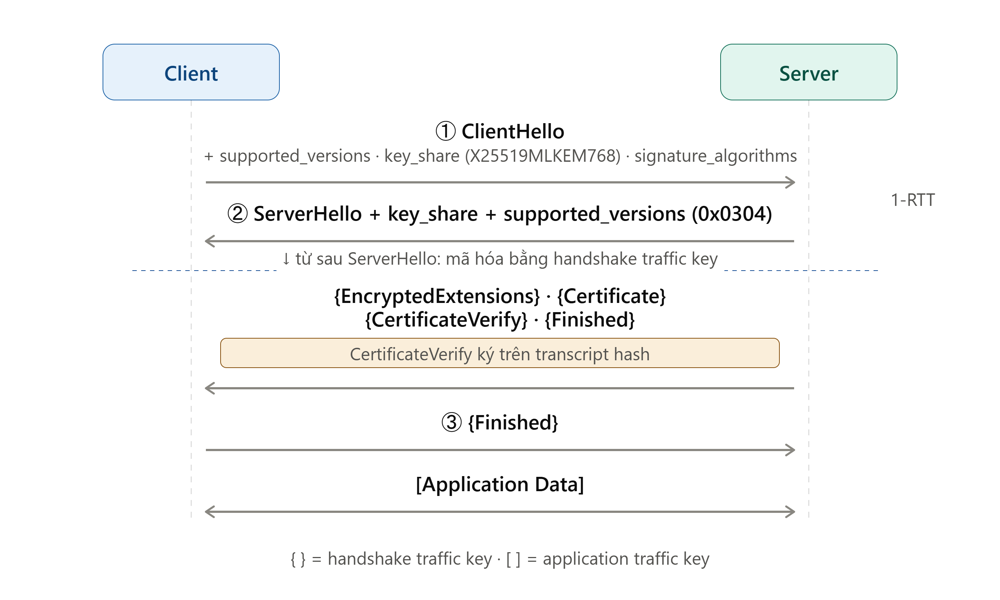

Khác biệt lớn nhất so với TLS 1.2: client **đoán trước** nhóm (EC)DHE và gửi luôn khóa công khai ngay trong bản tin đầu, nên chỉ cần **1-RTT** là xong handshake (so với 2-RTT ở TLS 1.2). Diễn giải chi tiết từng bước:

**① ClientHello (Client → Server).** Vẫn gửi rõ (chưa mã hóa), nhưng nhồi sẵn nhiều thông tin để tiết kiệm vòng:

- `supported_versions` (extension type 43): liệt kê phiên bản thật, ví dụ `[0x0304, 0x0303]`. Trường `legacy_version` trong record vẫn để `0x0303` nhằm qua mặt middlebox cũ — phiên bản thật **chỉ** nằm ở extension này.
- `key_share`: **khóa công khai (EC)DHE client sinh sẵn** cho một hoặc vài nhóm nó đoán server sẽ chọn (ví dụ `X25519MLKEM768`, `X25519`). Đây là điểm mấu chốt giúp 1-RTT: client không chờ server chọn nhóm rồi mới gửi khóa.
- `supported_groups`: các nhóm client hỗ trợ (phòng khi server không thích nhóm đã gửi key_share). `signature_algorithms`: thuật toán chữ ký client chấp nhận cho chứng chỉ.
- `psk_key_exchange_modes` / `pre_shared_key`: chỉ xuất hiện khi nối lại phiên (resumption) hoặc dùng 0-RTT.

**② ServerHello + các bản tin được mã hóa (Server → Client).** Server trả lời trong một lượt. Chỉ **ServerHello** là gửi rõ, **mọi thứ sau đó đã được mã hóa** (đây là khác biệt lớn so với TLS 1.2, nơi chứng chỉ gửi rõ):

- **ServerHello**: `supported_versions = 0x0304` (chốt TLS 1.3) + `key_share` chứa **khóa công khai (EC)DHE của server**. Ngay sau bản tin này, **cả hai bên đã tính được bí mật chung (EC)DHE** và dẫn xuất **handshake traffic key** để mã hóa phần còn lại.
- `{EncryptedExtensions}`: các extension không bí mật nhưng nay cũng được giấu (ALPN, SNI…).
- `{Certificate}`: chuỗi chứng chỉ server — **đã mã hóa**, nên kẻ nghe lén không thấy server là ai.
- `{CertificateVerify}`: server **ký bằng khóa riêng** (RSA-PSS/ECDSA/EdDSA) lên **hash của toàn bộ transcript tính đến thời điểm đó**. Khác TLS 1.2 (chỉ ký randoms + params), chữ ký này phủ **toàn bộ** nội dung handshake ⇒ chống sửa đổi/hạ cấp mạnh hơn hẳn.
- `{Finished}`: MAC trên transcript bằng khóa handshake, chứng minh server nắm đúng khóa và transcript toàn vẹn.

Client giải mã, xác minh chứng chỉ (CA, hạn, SAN khớp hostname), **verify CertificateVerify** và **Finished**. Chỉ khi tất cả đạt mới đi tiếp.

**③ {Finished} (Client → Server).** Client gửi Finished của mình (đã mã hóa) để xác nhận. Từ đây hai bên chuyển sang **application traffic key** và bắt đầu truyền **[Application Data]** mã hóa AEAD hai chiều. (Server được phép gửi Application Data sớm ngay sau Finished của nó, trước khi nhận Finished của client — nên tổng chi phí vẫn là 1-RTT.)

**Quy ước ký hiệu trên ảnh:** `{...}` = bản tin mã hóa bằng **handshake traffic key**; `[...]` = mã hóa bằng **application traffic key**. Các khóa này được dẫn xuất tuần tự bằng **HKDF** (xem key schedule ở mục 1.4.2), mỗi bước đều trộn thêm transcript hash nên khóa gắn chặt với nội dung handshake.

#### 1.4.2. Thay đổi cốt lõi so với TLS 1.2

| Thay đổi | Chi tiết |
|---|---|
| **1-RTT** | Client gửi key share ngay trong ClientHello; đoán sai group ⇒ HelloRetryRequest (2-RTT) |
| **0-RTT (early data)** | Với resumption bằng PSK, client gửi dữ liệu ngay. **Không có forward secrecy và có thể bị replay** (RFC 8446) ⇒ chỉ dùng cho request idempotent; server phải chống replay |
| **Chỉ (EC)DHE / PSK** | Bỏ RSA key transport và DH tĩnh ⇒ mọi chế độ (trừ PSK-only) đều có forward secrecy |
| **Bắt buộc AEAD** | Chỉ còn 5 cipher suite: `TLS_AES_128_GCM_SHA256` (0x1301), `TLS_AES_256_GCM_SHA384` (0x1302), `TLS_CHACHA20_POLY1305_SHA256` (0x1303), `TLS_AES_128_CCM_SHA256` (0x1304), `TLS_AES_128_CCM_8_SHA256` (0x1305). Trao đổi khóa và chữ ký thương lượng **riêng** |
| **HKDF** (RFC 5869) | Key schedule: Early → Handshake → Master Secret, mỗi bước gắn với transcript hash |
| **Mã hóa handshake sớm** | Từ sau ServerHello, mọi thứ (kể cả chứng chỉ) được mã hóa |
| **CertificateVerify ký toàn bộ transcript** | Khác TLS 1.2 chỉ ký randoms + params |
| **Loại bỏ** | Renegotiation, nén, CBC, RC4, SHA-1/MD5 trong chữ ký, nhóm DH tùy ý, export |

#### 1.4.3. Thương lượng phiên bản

Do nhiều server/middlebox lỗi khi gặp giá trị version lạ ("version intolerance"), TLS 1.3 **đóng băng** trường `legacy_version = 0x0303` (TLS 1.2) trong ClientHello/ServerHello và record layer, rồi thương lượng phiên bản thật qua extension **`supported_versions` (type 43)**:

- Client liệt kê các phiên bản hỗ trợ theo thứ tự ưu tiên, ví dụ `[0x0304, 0x0303]`.
- Server hỗ trợ 1.3: chọn một giá trị và trả `supported_versions = 0x0304` trong ServerHello.
- Server chỉ hỗ trợ 1.2: **bỏ qua** extension và chọn phiên bản theo `legacy_version` ⇒ TLS 1.2.

Đây chính là điểm mà một tấn công hạ phiên bản sẽ nhắm vào: nếu MITM xóa được extension `supported_versions` khỏi ClientHello, server sẽ "tưởng" client chỉ biết TLS 1.2. Cơ chế chống lại tình huống này được trình bày ở mục 1.4.4.

#### 1.4.4. Cơ chế chống hạ phiên bản

**(1) Sentinel trong `ServerHello.random` (RFC 8446 §4.1.3).** RFC 8446 quy định: nếu một server **có hỗ trợ TLS 1.3** mà lần thương lượng này lại chốt xuống phiên bản thấp hơn (1.2 hoặc cũ hơn), thì nó **phải** đặt một chuỗi 8 byte cố định (gọi là *sentinel* — "cờ báo hạ cấp") vào **8 byte cuối** của trường `server_random`:

| Phiên bản thương lượng | 8 byte cuối của `ServerHello.random` |
|---|---|
| TLS 1.2 | `44 4F 57 4E 47 52 44 01` = `"DOWNGRD\x01"` |
| TLS 1.1 trở xuống | `44 4F 57 4E 47 52 44 00` = `"DOWNGRD\x00"` |

Client TLS 1.3 khi nhận ServerHello có phiên bản ≤ 1.2 **phải** kiểm tra 8 byte này; nếu khớp sentinel thì hủy với alert `illegal_parameter`. Ý tưởng: một server "biết" TLS 1.3 sẽ cố ý để lại dấu hiệu khi nó rơi xuống phiên bản thấp; client "biết" TLS 1.3 đọc được dấu hiệu đó. Nếu việc hạ cấp là do MITM ép (chứ không phải do server thật chỉ hỗ trợ 1.2), client phát hiện được ngay.

**(2) Vì sao kẻ tấn công không thể xóa sentinel.** Đây là lập luận then chốt:

- Trong ECDHE (TLS 1.2), `server_random` nằm trong dữ liệu được server **ký** ở ServerKeyExchange. Sửa random ⇒ chữ ký sai ⇒ client (đã xác thực chứng chỉ) phát hiện và hủy. MITM **không có khóa riêng server** nên không ký lại được.
- Ở mọi chế độ, `Finished` MAC phủ toàn bộ transcript (gồm cả ClientHello đã bị sửa); MITM không biết master secret nên không giả được Finished.
- Điểm tinh tế: sentinel bổ sung một lớp bảo vệ **dựa trên khóa dài hạn** cho tình huống thuật toán TLS 1.2 **yếu** (như Logjam, nơi MITM có thể phá trao đổi khóa và giả Finished). Vì chữ ký vẫn phủ `server_random`, lớp này không sụp đổ cùng với trao đổi khóa.

**(3) `TLS_FALLBACK_SCSV` (RFC 7507).** Dành cho client có hành vi "fallback dance" (tự thử lại phiên bản thấp hơn khi kết nối lỗi). Khi thử lại, client thêm SCSV `0x5600` vào danh sách cipher suite; server hỗ trợ phiên bản cao hơn mà thấy SCSV sẽ trả alert `inappropriate_fallback` (86). Cơ chế này bịt lỗ hổng mà sentinel không che được: khi client tự hạ cấp ở lần kết nối sau, ClientHello mới không còn quảng bá TLS 1.3 nên server không có cớ để đặt sentinel.

**Giới hạn của cơ chế chống hạ phiên bản.** Các cơ chế trên bảo vệ được nhiều, nhưng có những ranh giới cố hữu:

| Giới hạn | Giải thích |
|---|---|
| Chỉ hiệu lực khi **cả hai** bên hỗ trợ TLS 1.3 | Server chỉ hỗ trợ 1.2 thì không đặt sentinel ⇒ TLS 1.2 là kết quả thương lượng hợp lệ, không phải tấn công |
| Phụ thuộc client **thực sự kiểm tra** sentinel | Cài đặt tự viết/cũ/lỗi có thể bỏ qua bước kiểm tra này |
| Phụ thuộc **xác thực chứng chỉ** | Nếu client không verify chứng chỉ hoặc tin CA của kẻ tấn công, MITM có thể tự đóng vai server và kết thúc một phiên TLS 1.2 hợp lệ — không có gì để phát hiện |
| Không chống **fallback ở tầng ứng dụng** | Client tự thử lại với max = 1.2: ClientHello mới không còn 1.3 ⇒ server không đặt sentinel; chỉ SCSV cứu được |
| Không chống lộ **khóa riêng server** | Kẻ có khóa riêng ký được ServerKeyExchange giả, qua mặt lớp bảo vệ dựa trên chữ ký |
| Không chống **DoS** | MITM luôn có thể làm kết nối thất bại; khi đó "hạ cấp" chỉ biến thành "ngắt kết nối" chứ không giúp nghe lén |

---

### 1.5. Thư viện mật mã và TLS

#### 1.5.1. So sánh hỗ trợ TLS 1.3 và PQC/hybrid (7 thư viện)

| Thư viện | TLS 1.3 | ML-KEM / hybrid trong TLS | ML-DSA / SLH-DSA | Ghi chú |
|---|---|---|---|---|
| **OpenSSL** | Từ 1.1.1 (09/2018) | **3.5** (08/04/2025): `X25519MLKEM768`, `SecP256r1MLKEM768`, `SecP384r1MLKEM1024` trong default groups | 3.5: ML-DSA, SLH-DSA (dùng được cả cho chứng chỉ) | 3.5 là LTS (hỗ trợ tới 04/2030). Bản dùng trong báo cáo: **3.5.5** |
| **BoringSSL** | Có (2016–2017) | `X25519MLKEM768` (ML-KEM share đứng trước; thay `X25519Kyber768Draft00`), đã vào default groups | ML-DSA-44/65/87 ở mức thư viện (OID/NID + ký/xác minh, từ đầu 2025); chưa dùng làm sigalg trong TLS | Dùng cho Chrome, Android; không có bản phát hành đánh số chính thức |
| **Go crypto/tls** | Từ Go 1.12 (mặc định 1.13) | Go 1.23: `X25519Kyber768Draft00`; **Go 1.24+**: `X25519MLKEM768` mặc định (gói `crypto/mlkem`); **Go 1.26** thêm `SecP256r1MLKEM768`, `SecP384r1MLKEM1024` | ML-DSA chưa vào stdlib ở 1.26; gói `crypto/mldsa` (FIPS 204) có **từ Go 1.27** | Tắt hybrid bằng `GODEBUG=tlsmlkem=0` / `tlssecpmlkem=0`. Bản dùng trong báo cáo: **1.26.8** |
| **rustls** | Có (chỉ TLS 1.2 và 1.3) | Tích hợp sẵn từ 0.23.22 (feature `prefer-post-quantum`), **mặc định bật từ 0.23.27**; provider `aws-lc-rs`: `X25519MLKEM768`, `SecP256r1MLKEM768` | ML-DSA qua crate `rustls-post-quantum` (còn thử nghiệm); backend `ring` không hỗ trợ hybrid | Không hỗ trợ TLS ≤ 1.1, không có suite CBC/RSA-kx |
| **wolfSSL** | Có (từ 3.x) | `X25519MLKEM768`, `SecP384r1MLKEM1024`… trong TLS 1.3 (`--enable-mlkem`) | ML-DSA (44/65/87) trong sigalgs; LMS, XMSS (verify trong (D)TLS 1.3) | Nhắm thiết bị nhúng. wolfCrypt có FIPS 140-3 (#4718/#5041); **chứng nhận FIPS cho PQC đang tiến hành**, ML-KEM/ML-DSA mới có CAVP |
| **Mbed TLS** | 3.x; mặc định từ 3.6 LTS | **Chưa** — maintainer xác nhận (07/2026) PQC cho TLS/X.509 chưa nằm trong roadmap | Chỉ LMS (verify); đang phát triển `mldsa-native` | Dùng nhiều trên vi điều khiển (TF-M) |
| **Java JSSE** | JDK 11 (backport 8u261) | JDK 24: ML-KEM trong JCA (JEP 496) nhưng **chưa dùng cho TLS**; hybrid TLS 1.3 (`X25519MLKEM768`, `SecP256r1MLKEM768`, `SecP384r1MLKEM1024`) vào **JDK 27** (JEP 527) | JDK 24: ML-DSA trong JCA (JEP 497) | JEP 527 không đặt mục tiêu hỗ trợ ML-KEM thuần (non-hybrid) cho TLS |

#### 1.5.2. Hướng dẫn cấu hình (2 thư viện: OpenSSL và Go)

##### A. OpenSSL 3.5.5

OpenSSL tách **`-cipher`** (cho TLS ≤ 1.2, dùng cú pháp cipher string) và **`-ciphersuites`** (cho TLS 1.3, danh sách tên suite).

```bash
# Server: cho phép TLS 1.2–1.3, giới hạn cipher và nhóm khóa
openssl s_server -accept 8443 -cert server.crt -key server.key \
  -min_protocol TLSv1.2 -max_protocol TLSv1.3 \
  -cipher 'ECDHE+AESGCM:ECDHE+CHACHA20:!aNULL:!MD5:!SHA1' \
  -ciphersuites 'TLS_AES_256_GCM_SHA384:TLS_AES_128_GCM_SHA256:TLS_CHACHA20_POLY1305_SHA256' \
  -groups 'X25519MLKEM768:X25519:secp256r1' -www

# Client: ép chỉ TLS 1.3, xác thực chứng chỉ NGHIÊM NGẶT (verify + hostname)
openssl s_client -connect example.com:8443 -servername example.com \
  -CAfile ca.crt -verify_return_error -verify_hostname example.com \
  -tls1_3 -groups X25519MLKEM768

# Client: ép chỉ TLS 1.2
openssl s_client -connect example.com:8443 -servername example.com \
  -CAfile ca.crt -verify_return_error -verify_hostname example.com -tls1_2

# Server giới hạn tối đa TLS 1.2 (ví dụ cấu hình chỉ bật 1.2)
openssl s_server ... -no_tls1_3          # hoặc -max_protocol TLSv1.2
```

**Giải nghĩa tham số:**

| Cờ | Ý nghĩa | Giá trị đưa vào |
|---|---|---|
| `-accept 8443` | Cổng TCP server lắng nghe | Số cổng |
| `-connect example.com:8443` | Địa chỉ `host:port` client kết nối tới | Tên miền/IP + cổng |
| `-cert` / `-key` | Chứng chỉ và khóa riêng của server | Đường dẫn file PEM |
| `-CAfile` | Tập CA mà **client** tin để xác minh chứng chỉ server | Đường dẫn file PEM chứa chứng chỉ CA |
| `-min_protocol` / `-max_protocol` | Chặn dưới/chặn trên phiên bản TLS được phép | `TLSv1.2`, `TLSv1.3`… |
| `-tls1_3` / `-tls1_2` | Ép **đúng một** phiên bản (tương đương đặt min = max) | (không có giá trị, là cờ bật/tắt) |
| `-no_tls1_3` | Loại bỏ TLS 1.3 khỏi danh sách được phép | (cờ bật/tắt) |
| `-cipher` | Danh sách cipher suite cho **TLS ≤ 1.2**, dùng *cipher string* | Chuỗi, ngăn bằng `:` (xem cú pháp dưới) |
| `-ciphersuites` | Danh sách cipher suite cho **TLS 1.3**, dùng *tên IANA đầy đủ* | Tên suite ngăn bằng `:`, theo thứ tự ưu tiên |
| `-groups` | Các nhóm khóa (EC)DHE/hybrid được phép, theo thứ tự ưu tiên | Tên nhóm ngăn bằng `:` |
| `-servername` | Tên gửi trong SNI (để server chọn đúng chứng chỉ) | Tên miền |
| `-verify_return_error` | Hủy handshake ngay nếu xác minh chứng chỉ thất bại (thay vì chỉ cảnh báo) | (cờ bật/tắt) |
| `-verify_hostname` | Kiểm tra tên miền có khớp SAN/CN của chứng chỉ không | Tên miền cần khớp |
| `-www` | Cho `s_server` trả một trang HTTP đơn giản để test | (cờ bật/tắt) |

**Cú pháp giá trị `-cipher` (cipher string, chỉ TLS ≤ 1.2):** là danh sách *token* ngăn bằng dấu `:`, duyệt từ trái sang:

- `ECDHE+AESGCM` — phép giao: chọn các suite **vừa** dùng trao đổi khóa ECDHE **vừa** dùng AES-GCM (`+` = AND).
- `ECDHE+CHACHA20` — tương tự, với ChaCha20-Poly1305.
- Tiền tố `!` = **loại trừ vĩnh viễn** (không thể bật lại): `!aNULL` bỏ suite không xác thực, `!MD5` bỏ suite dùng MD5, `!SHA1` bỏ suite dùng HMAC-SHA1.
- Thứ tự token quyết định thứ tự ưu tiên. (Các toán tử khác: `+` sắp xuống cuối, `-` bỏ nhưng có thể thêm lại.)

→ Chuỗi `'ECDHE+AESGCM:ECDHE+CHACHA20:!aNULL:!MD5:!SHA1'` nghĩa là: chỉ cho phép ECDHE với AES-GCM hoặc ChaCha20, và cấm tuyệt đối mọi suite không xác thực/MD5/SHA-1.

**Cú pháp giá trị `-ciphersuites` (chỉ TLS 1.3):** TLS 1.3 chỉ có 5 suite cố định nên không dùng cú pháp lọc; chỉ liệt kê **tên IANA đầy đủ** theo thứ tự ưu tiên, ví dụ `TLS_AES_256_GCM_SHA384` đứng trước `TLS_AES_128_GCM_SHA256`.

File cấu hình toàn hệ thống (`openssl.cnf`):

```ini
[tls_defaults]
MinProtocol  = TLSv1.2
MaxProtocol  = TLSv1.3
CipherString = ECDHE+AESGCM:ECDHE+CHACHA20:!aNULL
Ciphersuites = TLS_AES_256_GCM_SHA384:TLS_AES_128_GCM_SHA256:TLS_CHACHA20_POLY1305_SHA256
Groups       = X25519MLKEM768:X25519:secp256r1
```

##### B. Go crypto/tls (Go 1.26.8)

```go
cfg := &tls.Config{
    MinVersion: tls.VersionTLS12,
    MaxVersion: tls.VersionTLS13,
    // CipherSuites CHỈ áp dụng cho TLS 1.0–1.2; suite TLS 1.3 không cấu hình được
    CipherSuites: []uint16{
        tls.TLS_ECDHE_ECDSA_WITH_AES_128_GCM_SHA256,
        tls.TLS_ECDHE_RSA_WITH_AES_128_GCM_SHA256,
    },
    CurvePreferences: []tls.CurveID{tls.X25519MLKEM768, tls.X25519, tls.CurveP256},
    RootCAs:    pool,          // client: tin đúng CA
    ServerName: "example.com", // KHÔNG đặt InsecureSkipVerify = true
}
// Sau handshake, đọc bằng chứng phiên bản:
st := conn.ConnectionState()
fmt.Println(tls.VersionName(st.Version), tls.CipherSuiteName(st.CipherSuite))
```

**Giải nghĩa các trường `tls.Config`:**

| Trường | Ý nghĩa | Giá trị đưa vào |
|---|---|---|
| `MinVersion` / `MaxVersion` | Chặn dưới/chặn trên phiên bản TLS | Hằng `tls.VersionTLS12`, `tls.VersionTLS13` |
| `CipherSuites` | Danh sách suite cho **TLS 1.0–1.2** theo thứ tự ưu tiên; **không** áp dụng cho TLS 1.3 (suite 1.3 do Go tự quản) | Slice hằng `uint16`, ví dụ `tls.TLS_ECDHE_RSA_WITH_AES_128_GCM_SHA256` |
| `CurvePreferences` | Các nhóm khóa (EC)DHE/hybrid được phép, theo thứ tự ưu tiên | Slice `tls.CurveID`: `tls.X25519MLKEM768`, `tls.X25519`, `tls.CurveP256` |
| `RootCAs` | Tập CA mà **client** tin để xác minh chứng chỉ server | `*x509.CertPool` (ở đây là `pool`) |
| `ServerName` | Tên miền kỳ vọng — vừa gửi SNI vừa là tên để **khớp hostname** khi verify | Chuỗi tên miền |
| `InsecureSkipVerify` | Nếu đặt `true` sẽ **tắt toàn bộ** xác minh chứng chỉ — **tuyệt đối không đặt** trong môi trường thật | Bỏ trống ⇒ mặc định `false` (an toàn) |

Khác với OpenSSL, Go **không cho cấu hình suite TLS 1.3** (chỉ dùng `CipherSuites` cho ≤ 1.2); verify chứng chỉ và khớp hostname được bật **mặc định** khi đã đặt `RootCAs` + `ServerName` và không bật `InsecureSkipVerify`. Sau handshake, `conn.ConnectionState()` cho biết phiên bản (`st.Version`) và suite (`st.CipherSuite`) thực tế đã thương lượng.

- Tắt hybrid: biến môi trường `GODEBUG=tlsmlkem=0`.
- Go client TLS 1.3 **tự kiểm tra sentinel downgrade** trong `crypto/tls` (mục 1.4.4) — không cần cấu hình thêm.

---

## Phần 2 – Câu hỏi nghiên cứu: có thể ép TLS 1.3 xuống TLS 1.2 không?

### 2.1. Câu trả lời

> **KHÔNG.** Khi client và server đều hỗ trợ TLS 1.3, được cấu hình đúng chuẩn RFC 8446, và client xác thực chứng chỉ server nghiêm ngặt (verify chuỗi tin cậy **và** khớp hostname), một kẻ tấn công MITM chủ động **không thể** buộc hai bên thương lượng TLS 1.2. Mọi can thiệp vào quá trình thương lượng phiên bản đều bị phát hiện và kết nối bị hủy. Kẻ tấn công chỉ có thể gây **gián đoạn (DoS)**, không thể hạ phiên bản thành công.
>
> **Kết luận đảo thành CÓ** khi xuất hiện một điều kiện **ngoài chuẩn** (chi tiết và phòng chống ở [2.4](#24-điều-kiện-làm-đổi-kết-luận-và-biện-pháp-phòng-chống)):
>
> 1. Client có cơ chế **fallback không an toàn** (tự nối lại với max = TLS 1.2 khi lỗi) mà không gửi `TLS_FALLBACK_SCSV`.
> 2. Client **không xác thực chứng chỉ** (hoặc tin CA của kẻ tấn công).
> 3. Client **không kiểm tra sentinel** `DOWNGRD`.
> 4. **Lộ khóa riêng** của server.

### 2.2. Lập luận lý thuyết

**Mô hình tấn công.** Xét kẻ tấn công MITM mạnh nhất trong mô hình chuẩn: **kiểm soát hoàn toàn đường mạng** (đọc, sửa, chặn, chèn gói tùy ý), nhưng **không có khóa riêng của server** và **không có CA nào mà client tin**. Câu hỏi đặt ra: kẻ đó có ép được hai bên — vốn đều hỗ trợ TLS 1.3 — thương lượng xuống TLS 1.2 mà không bị phát hiện hay không?

#### 2.2.1. Cấu hình chuẩn: không thể hạ cấp

Khi cả hai bên tuân thủ RFC 8446, mọi nỗ lực can thiệp vào quá trình thương lượng phiên bản đều **bị phát hiện và kết nối bị hủy** — không có đường nào dẫn tới một phiên TLS 1.2 bị hạ cấp âm thầm. Đây không chỉ là quan sát kỹ thuật mà đã được **chứng minh hình thức**: Bhargavan et al., *"Downgrade Resilience in Key-Exchange Protocols"* (IEEE S&P 2016, thực hiện cùng nhóm thiết kế TLS 1.3), chứng minh rằng khi đại lượng xác thực của server phủ cả phiên bản đã thương lượng thì giao thức đạt **"downgrade security"**.

An toàn này dựa trên **ba trụ**:

1. Server hỗ trợ 1.3 **luôn** nhúng sentinel `DOWNGRD` vào `server_random` khi buộc phải thương lượng xuống phiên bản thấp hơn.
2. `server_random` (chứa sentinel) được **chữ ký của khóa dài hạn** (đã xác thực qua chứng chỉ) bảo vệ — với RSA key transport thì do `Finished` MAC bảo vệ — nên MITM không sửa được.
3. Client **bắt buộc** kiểm tra cả sentinel lẫn chứng chỉ server.

Với ba trụ đó, mọi nước đi của MITM đều kết thúc bằng hủy kết nối:

| # | Hành động của MITM | Kết quả | Cơ chế phát hiện |
|---|---|---|---|
| A1 | Xóa `0x0304` khỏi `supported_versions` (hoặc xóa cả extension) | Server chọn TLS 1.2 **và** nhúng `DOWNGRD\x01` vào `server_random` | Client thấy sentinel ⇒ alert `illegal_parameter`, hủy |
| A2 | A1 + sửa `server_random` để xóa sentinel | Chữ ký ServerKeyExchange (phủ `client_random ‖ server_random ‖ params`) sai | Client verify chữ ký bằng chứng chỉ ⇒ hủy |
| A3 | A1 ở chế độ **static RSA key transport** + sửa `server_random` để xóa sentinel | RSA key transport **không ký** `server_random` (không có ServerKeyExchange) ⇒ trụ chữ ký ở A2 vô hiệu | Nhưng `server_random` là đầu vào của `master_secret`: sửa nó ⇒ hai bên dẫn xuất **khóa phiên khác nhau** ⇒ bản ghi `Finished` mã hóa fail ngay ở tầng AEAD/MAC ⇒ `bad_record_mac` |
| A4 | Sửa ServerHello TLS 1.3 thành dạng 1.2 | Phần sau ServerHello đã mã hóa bằng khóa TLS 1.3 | Không chuyển được ngữ cảnh ⇒ handshake hỏng |
| A5 | Chặn/RST ClientHello TLS 1.3 để ép client thử lại | Client chuẩn **không** fallback | Kết nối lỗi — **chỉ là DoS** |
| A6 | Tự kết thúc TLS 1.2 bằng chứng chỉ giả | — | Client verify nghiêm ngặt ⇒ `unknown_ca`/`certificate verify failed` |

**Kết luận:** mọi nhánh đều dẫn tới hủy kết nối; kẻ tấn công nhiều nhất chỉ gây **gián đoạn (DoS — nhánh A5)**, không bao giờ đạt được một phiên TLS 1.2 bị hạ cấp. Đây là cơ sở cho câu trả lời "KHÔNG" ở mục 2.1.

#### 2.2.2. Các lỗi triển khai đã xuất hiện trong thực tế

Hệ quả trực tiếp của lập luận trên: cách **duy nhất** để hạ cấp 1.3 → 1.2 là **phá vỡ một trong ba trụ**, và điều đó chỉ xảy ra khi có **lỗi triển khai hoặc cấu hình**, chứ không phải lỗi của giao thức. Thực tế đã ghi nhận đúng các ca như vậy — mỗi ca ứng với một trụ bị thiếu:

- **Thiếu trụ (3) — client không kiểm tra sentinel: CVE-2026-26994 (uTLS ≤ 1.6.7, 2026).** uTLS (bản fork của Go `crypto/tls` để tùy biến ClientHello) **không port** bước kiểm tra downgrade của RFC 8446 §4.1.3. Kẻ tấn công chủ động **xóa extension `supported_versions`** khỏi ClientHello ⇒ server trả ServerHello TLS 1.2 **có** đặt sentinel `DOWNGRD` trong `server_random`, nhưng uTLS **không kiểm tra** nên chấp nhận kết nối đã bị hạ cấp. Đây đúng là **nhánh A1 thành công vì thiếu trụ (3)**. Đã sửa ở bản 1.7.0.
- **Thiếu trụ (1) — server không gửi sentinel: lỗi GnuTLS.** Khi GnuTLS tắt TLS 1.3 và thương lượng xuống 1.0/1.1, bản lỗi **không nhúng sentinel** vào `server_random` (phát hiện bằng bộ test `test-downgrade-protection` của tlsfuzzer). Server hỗ trợ phiên cao mà không đặt sentinel thì client mất căn cứ để phát hiện hạ cấp.
- **Vô hiệu trụ (2) ở tầng hạ tầng — Chrome, 2019.** Một số proxy chặn/giải mã TLS không tuân chuẩn **sao chép nguyên `server_random`** (gồm cả sentinel) từ kết nối thật, khiến client không phát hiện hạ cấp. Google phải "siết" (hardening) lại trong Chrome 81, nhưng vẫn phải chừa ngoại lệ cho chứng chỉ chuỗi tới CA lạ — minh họa ranh giới "phụ thuộc xác thực chứng chỉ".

Điểm chung: tất cả đều là **vi phạm một trụ cụ thể**, không phải lỗ hổng trong thiết kế thương lượng của TLS 1.3. Điều này củng cố — chứ không mâu thuẫn với — kết luận ở 2.2.1.

#### 2.2.3. Các điều kiện khác có thể làm đảo kết luận

Ngoài các lỗi đã quan sát ở trên, về lý thuyết còn những cấu hình khác cũng phá được một trụ và khiến hạ cấp thành công, ví dụ: client có cơ chế **fallback tự tụt xuống 1.2** mà không gửi `TLS_FALLBACK_SCSV`; hoặc client **không xác thực chứng chỉ** (hoặc tin CA của kẻ tấn công). Các điều kiện này cùng biện pháp phòng chống cụ thể cho client và server được phân tích đầy đủ ở [mục 2.4](#24-điều-kiện-làm-đổi-kết-luận-và-biện-pháp-phòng-chống), và được tái hiện bằng lab ở Phần 3.

### 2.3. Bằng chứng từ lab (tóm tắt — chi tiết ở Phần 3)

| Kịch bản | Điều chứng minh | Bằng chứng |
|---|---|---|
| **S1** | Không can thiệp ⇒ hai bên chọn 1.3 | `New, TLSv1.3, Cipher is TLS_AES_256_GCM_SHA384` |
| **S2** | MITM xóa `supported_versions` ⇒ **client hủy, hạ cấp thất bại** | `ssl_choose_client_version:inappropriate fallback` |
| **S2b** | Server đặt sentinel đúng chuẩn | `server_random` tận cùng `44 4f 57 4e 47 52 44 01` = `DOWNGRD\x01` |
| **S3** | MITM ghi đè sentinel trong `server_random`, nhưng ở **ECDHE** random này được server **ký trong ServerKeyExchange** ⇒ chữ ký sai, client bắt được (nhánh A2) | `tls_process_key_exchange:bad signature` → Alert `decrypt_error` (51); `s3.txt`: random bị ghi đè `00…00` |
| **S4** | MITM xóa sentinel + static RSA ⇒ **Finished bắt** (nhánh A3) | `bad record mac` (SSL alert number 20), hủy ở Finished |
| **S5** | Client fallback không an toàn ⇒ **hạ cấp thành công** | `New, TLSv1.2, Cipher is ECDHE-RSA-AES256-GCM-SHA384` |
| **S5b** | Fallback + SCSV ⇒ server chặn | `tlsv1 alert inappropriate fallback ... alert number 86` |
| **S6** | MITM tự kết thúc TLS bằng cert giả, chỉ 1.2 | verify on ⇒ `self-signed certificate` → `certificate verify failed`; verify off ⇒ `TLSv1.2` (cert `Evil-MITM`) |


### 2.4. Điều kiện làm đổi kết luận và biện pháp phòng chống

| Điều kiện | Vì sao bị hạ cấp | Phòng chống phía **client** | Phòng chống phía **server** |
|---|---|---|---|
| **C1. Fallback không an toàn** (S5) | ClientHello thử lại chỉ còn ≤1.2 ⇒ client không chào 1.3 nên **không kiểm** sentinel (dù server vẫn đặt) | Bỏ cơ chế fallback; nếu buộc phải có thì gửi `TLS_FALLBACK_SCSV` | Hỗ trợ SCSV (OpenSSL mặc định có), trả `inappropriate_fallback` |
| **C2. Không xác thực chứng chỉ** (A6) | MITM trở thành đầu cuối TLS của client | Bật verify + **hostname** (`CERT_REQUIRED`, không `InsecureSkipVerify`, không `-k`, có `-verify_hostname`); cân nhắc certificate pinning cho app di động/IoT | HSTS (web) để trình duyệt từ chối bỏ qua lỗi chứng chỉ |
| **C3. Client bỏ qua sentinel** | Vô hiệu lớp bảo vệ chính | Dùng thư viện được duy trì tốt, cập nhật; kiểm thử bằng công cụ hạ cấp | — |
| **C4. Lộ khóa riêng server** | MITM ký được ServerKeyExchange/CertificateVerify giả | OCSP/CRL, chứng chỉ ngắn hạn | **Giữ khóa trong HSM** (PKCS#11, không xuất plaintext — yêu cầu FIPS 140-3), xoay vòng khóa |
| **Chung** (khi buộc phải chấp nhận 1.2) | Giảm thiểu rủi ro trong 1.2 | Chỉ cho phép ECDHE + AEAD; bật EMS (RFC 7627) | Tắt `TLS_RSA_*`, CBC, RC4, SHA-1; bật EMS; tắt renegotiation |

---

## Phần 3 – Laboratory

### 3.1. Môi trường (đã kiểm tra thực tế)

| Thành phần | Phiên bản | Ghi chú kiểm tra |
|---|---|---|
| OS | Ubuntu 26.04 LTS, kernel 6.18 (WSL2) | `/etc/os-release`, `uname -r` |
| CPU | 11th Gen Intel Core i7-11800H @ 2.30 GHz | dùng cho benchmark 1.2.3 |
| OpenSSL | **3.5.5** (27/01/2026) | `openssl list -kem-algorithms` xác nhận có ML-KEM-512/768/1024; `-tls-groups` có `X25519MLKEM768`, `SecP256r1MLKEM768`, `SecP384r1MLKEM1024` |
| Python | 3.14.4 | module `ssl` liên kết OpenSSL 3.5.5 |
| Go | 1.26.8 | client đối chứng (kiểm tra sentinel độc lập) |
| tcpdump | 4.99.6 (libpcap 1.10.6) | bắt gói và đọc lại pcap (`tcpdump -X -r`) |


### 3.2. Kiến trúc lab và PKI

**Thư mục:** `~/vist_test/tls-lab/`

```
tls-lab/
├── scripts/
│   ├── 00_make_ca.sh          # dựng PKI
│   └── run_all.sh             
├── ca/      ca.key (BÍ MẬT), ca.crt, ca.srl   
├── server/  server.key, server.csr, server.crt, san.cnf   
├── client/  ca.crt (neo tin cậy, bản sao công khai)       
├── mitm/    mitm_strip_versions.py, mitm.key, mitm.crt (cert giả S6)  
├── logs/    sX_client.log (đầu ra client) + sX_mitm.log (log MITM: S2/S3/S4)
├── pcap/    (file .pcap bắt được)
└── docker-compose.yml, README.md
```

**Topology** (ba vai, phân biệt bằng cổng trên loopback):

```
 client (openssl s_client)  ──►  MITM proxy (TCP, cổng 4434)  ──►  server (openssl s_server, cổng 4433)
      nạn nhân hợp lệ              kẻ tấn công chủ động               dịch vụ thật
```

**PKI:** `00_make_ca.sh` tạo một CA nội bộ RSA-2048 tự ký (`CN=TLS-Lab Internal CA`, `CA:TRUE`), rồi cấp chứng chỉ cho server:

- Subject `CN=lab.local`, **SAN** `DNS:lab.local, DNS:localhost, IP:127.0.0.1` (SAN là bắt buộc — client hiện đại khớp hostname theo SAN, bỏ qua CN).
- Server trình `server.crt`; client chỉ tin `ca.crt` ⇒ mô phỏng đúng tình huống "client xác thực nghiêm ngặt" của đề bài.

#### 3.2.1. Dựng PKI — từng lệnh

**Bước 1 — Tạo CA (khóa riêng + chứng chỉ tự ký) trong một lệnh.**

```bash
openssl req -x509 -newkey rsa:2048 -keyout ca/ca.key -out ca/ca.crt -days 365 -nodes \
  -subj "/C=VN/O=TLS-Lab/CN=TLS-Lab Internal CA"
```

- `-x509`: xuất thẳng **chứng chỉ tự ký** (không phải CSR) — đây là gốc tin cậy của lab.
- `-newkey rsa:2048`: sinh mới cặp khóa RSA-2048; `-keyout ca/ca.key` ghi khóa riêng, `-out ca/ca.crt` ghi chứng chỉ.
- `-nodes` (no DES): **không mã hóa** khóa riêng khi ghi ra đĩa — tiện cho lab tự động (không hỏi passphrase).
- `-days 365`: hạn 1 năm. `-subj`: đặt tên chủ thể không tương tác.
- *Kết quả:* `ca/ca.key` (khóa riêng CA) và `ca/ca.crt` (chứng chỉ CA, `CA:TRUE`). Chính `ca.crt` là thứ client sẽ `-CAfile` để tin.

**Bước 2 — Sinh khóa server và yêu cầu ký (CSR).**

```bash
openssl req -newkey rsa:2048 -keyout server/server.key -out server/server.csr -nodes \
  -subj "/C=VN/O=TLS-Lab/CN=lab.local"
```

- Không có `-x509` ⇒ lệnh tạo một **CSR** (`server.csr`) thay vì chứng chỉ. CSR chứa khóa **công khai** của server + thông tin chủ thể, và được **ký bằng khóa riêng của server** (chứng minh server nắm khóa riêng — proof-of-possession).
- *Kết quả:* `server/server.key` (khóa riêng server) và `server/server.csr` (yêu cầu ký gửi cho CA).

**Bước 3 — Khai báo SAN cho chứng chỉ server.**

```bash
printf 'subjectAltName=DNS:lab.local,DNS:localhost,IP:127.0.0.1\n' > server/san.cnf
```

- SAN (Subject Alternative Name) liệt kê các tên mà chứng chỉ hợp lệ. **Bắt buộc** vì client hiện đại khớp hostname theo SAN và bỏ qua CN. Đưa vào file để truyền cho bước ký bằng `-extfile`.

**Bước 4 — CA ký CSR của server ⇒ chứng chỉ server.**

```bash
openssl x509 -req -in server/server.csr -CA ca/ca.crt -CAkey ca/ca.key -CAcreateserial \
  -out server/server.crt -days 365 -extfile server/san.cnf
```

- `x509 -req`: nhận một **CSR** làm đầu vào và xuất ra chứng chỉ đã ký.
- `-CA ca/ca.crt -CAkey ca/ca.key`: CA dùng **khóa riêng của mình** ký lên phần thông tin của server ⇒ bất kỳ ai tin `ca.crt` sẽ tin `server.crt`.
- `-CAcreateserial`: sinh file `ca/ca.srl` lưu số serial (mỗi chứng chỉ CA cấp có serial duy nhất).
- `-extfile server/san.cnf`: nhúng SAN vào chứng chỉ.
- *Kết quả:* `server/server.crt` — chứng chỉ server hợp lệ, chuỗi tin cậy `server.crt → ca.crt`.

**Bước 5 — Phân phối `ca.crt` cho client (bước "client nhận cert của CA").**

```bash
cp ca/ca.crt client/ca.crt
```

- Chỉ copy **cert công khai** `ca.crt` sang thư mục client — **không bao giờ** copy `ca/ca.key` (khóa riêng CA, tối mật). Đây là neo tin cậy client nạp **trước** mọi handshake; khi chạy trong `client/`, client dùng `-CAfile ca.crt`.
- Client **không** cần `server.crt`: server tự gửi chứng chỉ của mình trong thông điệp Certificate khi bắt tay. Client chỉ kiểm "cert server có dẫn về `ca.crt` không".
- *Kết quả:* `client/ca.crt`. (Môi trường thật: copy qua kênh tin cậy rồi cài vào kho tin cậy của client, ví dụ `/usr/local/share/ca-certificates/` + `update-ca-certificates`.)

**Bước 6 — Tạo chứng chỉ giả cho S6 (tự ký, KHÔNG do CA lab ký).**

```bash
openssl req -x509 -newkey rsa:2048 -keyout mitm/mitm.key -out mitm/mitm.crt -days 365 -nodes \
  -subj "/C=VN/O=Evil-MITM/CN=lab.local" \
  -addext "subjectAltName=DNS:lab.local,DNS:localhost,IP:127.0.0.1"
```

- Cũng `-x509` (tự ký) và SAN khớp `lab.local` **y hệt** server thật — nên **lý do duy nhất** client nghiêm ngặt từ chối nó là **không do CA tin cậy ký** (chứ không phải sai hostname). Đây là mấu chốt để S6 chứng minh vai trò của xác thực chuỗi tin cậy.
- *Kết quả:* `mitm/mitm.key`, `mitm/mitm.crt` — danh tính giả để MITM đóng vai server ở S6.

#### 3.2.2. Lệnh chạy server và client (khung chung cho các kịch bản)


**Server thật** — chạy trong `server/` (cổng 4433), ví dụ cho phép TLSv 1.2–1.3:

```bash
cd server
openssl s_server -accept 4433 -cert server.crt -key server.key -www -quiet \
  -min_protocol TLSv1.2 -max_protocol TLSv1.3
```

- `-cert/-key`: trình chứng chỉ + khóa server (tại chỗ trong `server/`). `-www`: trả một trang HTTP nhỏ để client có gì đọc. `-min/-max_protocol`: khung phiên bản cho phép (mỗi kịch bản chỉnh khác nhau).

**Client nghiêm ngặt** — chạy trong `client/` (giả thiết của đề bài), dùng cho mọi kịch bản:

```bash
cd client
openssl s_client -connect 127.0.0.1:4433 -servername lab.local \
  -CAfile ca.crt -verify_return_error -verify_hostname lab.local
```

- `-CAfile ca.crt`: chỉ tin đúng CA lab (bản sao `client/ca.crt` nhận ở bước 5). `-verify_return_error`: **hủy** ngay nếu xác minh chứng chỉ thất bại. `-verify_hostname lab.local`: bắt buộc khớp SAN. `-servername`: gửi SNI.
- Khi đi qua MITM, client đổi `-connect` sang cổng `4434` (proxy) hoặc `4435` (MITM-server ở S6).

**MITM** — chạy trong `mitm/`: `python3 -I mitm_strip_versions.py` (thêm `MANGLE_SENTINEL=1` ở S3/S4).

Nhờ `server.crt` là cert thật có SAN khớp, phần xác thực **luôn pass** trong S1–S5 ⇒ kết quả pass/fail của từng kịch bản phản ánh **lớp thương lượng phiên bản**, tách bạch khỏi lớp chứng chỉ (riêng S6 là nơi cố ý phá lớp chứng chỉ).

### 3.3. Kịch bản và kết quả


#### S1 — Baseline (không MITM)

Client nối thẳng server, cả hai bật 1.2–1.3. **Mục đích:** xác lập hành vi đúng khi không bị can thiệp.

**Thực hiện:**

- **① server**: `openssl s_server -accept 4433 -cert server.crt -key server.key -www -min_protocol TLSv1.2 -max_protocol TLSv1.3`
- **② MITM:** không có.
- **③ client**: `echo | openssl s_client -connect 127.0.0.1:4433 -servername lab.local -CAfile ca.crt -verify_return_error -verify_hostname lab.local 2>&1 | tee ../logs/s1_client.log`.
- **④ pcap**: `sudo tcpdump -i loopback0 -Z $USER -w pcap/s1.pcap 'tcp port 4433'`.

```
== S1 baseline ==
New, TLSv1.3, Cipher is TLS_AES_256_GCM_SHA384
Protocol: TLSv1.3
```

**Kết luận:** không ai can thiệp ⇒ hai bên tự chọn phiên bản cao nhất chung = **TLS 1.3**.

#### S2 — MITM xóa `supported_versions` (kịch bản tấn công chính)

Client đi qua MITM ở cổng 4434; MITM xóa extension `supported_versions` (type `0x002b`) khỏi ClientHello rồi chuyển tiếp tới server thật. **Mục đích:** mô phỏng đúng tấn công hạ phiên bản — ép server "tưởng" client chỉ biết 1.2.

**Thực hiện:**

- **① server**: `openssl s_server -accept 4433 -cert server.crt -key server.key -www -min_protocol TLSv1.2 -max_protocol TLSv1.3` (như S1).
- **② MITM**: `python3 -I mitm_strip_versions.py 2>>../logs/s2_mitm.log` — nghe `4434`, chuyển tiếp tới `4433`, xóa `supported_versions`.
- **③ client**: `echo | openssl s_client -connect 127.0.0.1:4434 -servername lab.local -CAfile ca.crt -verify_return_error -verify_hostname lab.local -min_protocol TLSv1.2 -max_protocol TLSv1.3 2>&1 | tee -a ../logs/s2_client.log`.
- **④ pcap:** `sudo tcpdump -i loopback0 -Z $USER -w pcap/s2.pcap 'tcp port 4433 or tcp port 4434'`

```
== S2 MITM strip supported_versions (expect abort) ==
...error:0A000175:SSL routines:ssl_choose_client_version:inappropriate fallback:...statem_lib.c:2436
```

**Kết luận:** server (vẫn hỗ trợ 1.3) chọn 1.2 và nhúng sentinel; client phát hiện và **hủy kết nối**. **Hạ cấp thất bại** — đây là bằng chứng trực tiếp cho câu trả lời "KHÔNG".

#### S2b — Bằng chứng trực quan sentinel

**Thực hiện:**

- **① server**: `openssl s_server -accept 4433 -cert server.crt -key server.key -www -min_protocol TLSv1.2 -max_protocol TLSv1.3`.
- **② MITM:** không có — ở đây ta chỉ muốn nhìn sentinel do server hợp lệ phát ra.
- **③ client**: `echo | openssl s_client -connect 127.0.0.1:4433 -servername lab.local -CAfile ca.crt -verify_return_error -verify_hostname lab.local -min_protocol TLSv1.2 -max_protocol TLSv1.2 -msg 2>&1 | sed -n '/ServerHello/,+5p' | tee ../logs/s2b_client.log`.
- **④ pcap:**`sudo tcpdump -i loopback0 -Z $USER -w pcap/s2b.pcap 'tcp port 4433'`.

```
02 00 00 3d        ServerHello, dài 61 byte
03 03              legacy_version = TLS 1.2
3a 9f ... 85 3a 1d 6a   24 byte đầu của server_random
44 4f 57 4e 47 52 44 01  ← 8 byte cuối = "DOWNGRD\x01" (SENTINEL)
00                 session_id length = 0
c0 30              cipher = TLS_ECDHE_RSA_WITH_AES_256_GCM_SHA384
00                 compression = null
00 15              extensions (21 B): renegotiation_info, ec_point_formats,
                   session_ticket, extended_master_secret
                   → KHÔNG có supported_versions (43) ⇒ phiên bản là TLS 1.2
```

**Kết luận:** server hỗ trợ 1.3 đã nhúng đúng sentinel `DOWNGRD\x01` theo RFC 8446. Vì cipher là ECDHE_RSA, `server_random` này được server ký ở ServerKeyExchange ⇒ MITM không thể xóa sentinel mà không làm hỏng chữ ký.

#### S3 — MITM xóa luôn sentinel, ECDHE (chữ ký bắt được)

Mở rộng S2: proxy chạy với `MANGLE_SENTINEL=1`, vừa xóa `supported_versions` (hướng client→server) vừa **ghi đè 8 byte cuối `server_random` về `00`** (hướng server→client) để thử xóa sentinel. Server dùng ECDHE nên `server_random` nằm trong dữ liệu được **ký** ở ServerKeyExchange.

**Thực hiện:**

- **① server**: `openssl s_server -accept 4433 -cert server.crt -key server.key -www -min_protocol TLSv1.2 -max_protocol TLSv1.3`.
- **② MITM**: `MANGLE_SENTINEL=1 python3 -I mitm_strip_versions.py 2>>../logs/s3_mitm.log` — `stderr` ghi thêm dòng `sentinel_zeroed=True`.
- **③ client**: `echo | openssl s_client -connect 127.0.0.1:4434 -servername lab.local -CAfile ca.crt -verify_return_error -verify_hostname lab.local -min_protocol TLSv1.2 -max_protocol TLSv1.3 2>&1 | tee -a ../logs/s3_client.log`.
- **④ pcap:** `sudo tcpdump -i loopback0 -Z $USER -w pcap/s3.pcap 'tcp port 4433 or tcp port 4434'`.

Bằng chứng gói tin (`s3.txt`) — cùng một `server_random` (prefix `… d6 4b fe`), hai phiên bản trên hai chặng:

```
leg 4433 (gốc từ server):  … d6 4b fe  44 4f 57 4e 47 52 44 01   ← DOWNGRD
leg 4434 (MITM ghi đè):    … d6 4b fe  00 00 00 00 00 00 00 00   ← sentinel bị xóa
```

Log client (`s3_client.log`):

```
[mitm] ... sentinel_zeroed=True
error:...rsa_pss_mgf1:bad signature:...
error:0A00007B:SSL routines:tls_process_key_exchange:bad signature:...
New, (NONE), Cipher is (NONE)
```

**Kết quả (thật):** sentinel bị MITM ghi đè `00…00` nên client không báo `illegal_parameter`, nhưng chữ ký ServerKeyExchange (phủ `server_random` đã bị sửa) **sai** ⇒ client hủy với `tls_process_key_exchange:bad signature`, gửi Alert `decrypt_error` (51), phiên `Cipher is (NONE)`. Hiện thực hóa **nhánh A2** — lớp chữ ký bắt được cái mà sentinel không còn.

#### S4 — MITM xóa sentinel, static RSA (Finished bắt được)

Server vẫn hỗ trợ 1.3 nhưng chỉ bật cipher **RSA key transport** cho 1.2 (`-cipher AES128-GCM-SHA256`), nên `server_random` **không được ký**. Proxy vẫn `MANGLE_SENTINEL=1`.

**Thực hiện:**

- **① server**: `openssl s_server -accept 4433 -cert server.crt -key server.key -www -min_protocol TLSv1.2 -max_protocol TLSv1.3 -cipher AES128-GCM-SHA256` — thêm `-cipher AES128-GCM-SHA256` để ép trao đổi khóa RSA tĩnh.
- **② MITM**: `MANGLE_SENTINEL=1 python3 -I mitm_strip_versions.py 2>>../logs/s4_mitm.log`.
- **③ client**: `echo | openssl s_client -connect 127.0.0.1:4434 -servername lab.local -CAfile ca.crt -verify_return_error -verify_hostname lab.local -cipher AES128-GCM-SHA256 -max_protocol TLSv1.2 2>&1 | tee -a ../logs/s4_client.log`.
- **④ pcap:** `sudo tcpdump -i loopback0 -Z $USER -w pcap/s4.pcap 'tcp port 4433 or tcp port 4434'`.

Log client (`s4_client.log`):

```
error:0A0003FC:SSL routines:ssl3_read_bytes:ssl/tls alert bad record mac:... SSL alert number 20
New, TLSv1.2, Cipher is AES128-GCM-SHA256   ← cipher đã chọn
```

**Kết quả:** không có chữ ký để bắt (static RSA) nên handshake đi xa hơn tới bước **Finished**; nhưng `master_secret` dẫn xuất từ `server_random` (client dùng bản MITM sửa, server dùng bản gốc) ⇒ hai bên lệch khóa ⇒ Finished sai MAC ⇒ client nhận Alert **`bad record mac` (SSL alert number 20)**, hủy. Hiện thực hóa **nhánh A3** — `Finished` là lớp chặn cuối.

#### S5 — Client fallback không an toàn (hạ cấp THÀNH CÔNG)

Mô phỏng client tự "hạ trần" xuống TLS 1.2, **không** gửi SCSV. **Mục đích:** cho thấy khi client tự bỏ 1.3 thì sentinel vô dụng.

**Thực hiện:**

- **① server**: `openssl s_server -accept 4433 -cert server.crt -key server.key -www -min_protocol TLSv1.2 -max_protocol TLSv1.3`.
- **② MITM:** không có — đây là lỗi tự thân của client, không cần kẻ tấn công.
- **③ client**: `echo | openssl s_client -connect 127.0.0.1:4433 -servername lab.local -CAfile ca.crt -verify_return_error -verify_hostname lab.local -max_protocol TLSv1.2 2>&1 | tee ../logs/s5_client.log`.
- **④ pcap:** `sudo tcpdump -i loopback0 -Z $USER -w pcap/s5.pcap 'tcp port 4433'` — client chỉ chào tối đa 1.2 nên server (vẫn hỗ trợ 1.3) **vẫn nhúng sentinel** `DOWNGRD` vào `server_random`; nhưng vì client **không chào 1.3** nên nó **không kiểm** sentinel ⇒ handshake hoàn tất. Khác S2 ở chỗ *client có chào 1.3 hay không*, **không** phải ở việc có sentinel hay không.

```
== S5 client fallback to 1.2 (downgrade succeeds) ==
New, TLSv1.2, Cipher is ECDHE-RSA-AES256-GCM-SHA384
Protocol: TLSv1.2
```

**Kết luận:** sentinel **không cứu** vì chính client đã không gửi 1.3 nữa — không còn mâu thuẫn để phát hiện. Lỗ hổng nằm ở **logic fallback của ứng dụng**, không phải ở giao thức.

#### S5b — Fallback kèm `TLS_FALLBACK_SCSV` (được chặn)

Như S5 nhưng thêm `-fallback_scsv` để báo cho server biết "đây là lần thử lại ở mức thấp". **Mục đích:** chứng minh biện pháp phòng chống đúng cho C1.

**Thực hiện:**

- **① server**: `openssl s_server -accept 4433 -cert server.crt -key server.key -www -min_protocol TLSv1.2 -max_protocol TLSv1.3`.
- **② MITM:** không có.
- **③ client**: `echo | openssl s_client -connect 127.0.0.1:4433 -servername lab.local -CAfile ca.crt -verify_return_error -verify_hostname lab.local -max_protocol TLSv1.2 -fallback_scsv 2>&1 | tee ../logs/s5b_client.log`. Cờ `-fallback_scsv` chèn `TLS_FALLBACK_SCSV` (0x5600) vào danh sách cipher của ClientHello.
- **④ pcap:** `sudo tcpdump -i loopback0 -Z $USER -w pcap/s5b.pcap 'tcp port 4433'` — thấy server trả `Alert (level=fatal, 86 inappropriate_fallback)` thay vì ServerHello.

```
== S5b fallback + TLS_FALLBACK_SCSV (server rejects) ==
...tlsv1 alert inappropriate fallback:... SSL alert number 86
```

**Kết luận:** server hiểu "client đang thử lại ở mức thấp dù tôi hỗ trợ cao hơn" và trả alert 86 (RFC 7507). Đây là **biện pháp phòng chống đúng cho C1**.

#### S6 — MITM tự kết thúc TLS bằng chứng chỉ giả

MITM không chuyển tiếp tới server thật mà **tự đóng vai server**

**Thực hiện:**

- **① server thật:** không tham gia — MITM thay thế hẳn nó.
- **② MITM-server**: `openssl s_server -accept 4435 -cert mitm.crt -key mitm.key -www -min_protocol TLSv1.2 -max_protocol TLSv1.2` (cert giả sinh ở 3.2.1 bước 6; chỉ bật 1.2).
- **③ client** chạy **hai lần** vào cổng 4435, ghi nối tiếp cùng một log:
  - *S6a — nghiêm ngặt:* `echo | openssl s_client -connect 127.0.0.1:4435 -CAfile ca.crt -verify_return_error -verify_hostname lab.local 2>&1 | tee ../logs/s6_client.log`.
  - *S6b — bỏ xác thực:* `echo | openssl s_client -connect 127.0.0.1:4435 2>&1 | tee -a ../logs/s6_client.log` (không `-CAfile`, không `-verify*`).
- **④ pcap:** `sudo tcpdump -i loopback0 -Z $USER -w pcap/s6.pcap 'tcp port 4435'` — trong pcap thấy **Certificate** mang subject `O=Evil-MITM` (cert của MITM), là bằng chứng client S6b đã bắt tay với kẻ giả mạo.

Log client (`s6_client.log`) và cert giả trong pcap (`s6.txt`):

```
-- S6a (verify on)  : verify error:num=18:self-signed certificate
                      error:0A000086:...tls_post_process_server_certificate:certificate verify failed
                      New, (NONE), Cipher is (NONE)
-- S6b (verify off) : Protocol: TLSv1.2   (chấp nhận cert giả)
s6.txt: Certificate chứa subject  ...O=Evil-MITM, CN=lab.local
```

**Kết quả:**

- **S6a (client nghiêm ngặt):** cert của MITM tự ký, không do CA lab ký ⇒ `verify error:num=18:self-signed certificate` → `certificate verify failed`, **hủy** (`Cipher is (NONE)`).
- **S6b (client bỏ verify):** chấp nhận cert giả ⇒ thiết lập **TLS 1.2** với MITM (`s6.txt` cho thấy Certificate mang `O=Evil-MITM`) ⇒ **hạ cấp thành công**. Minh chứng cho điều kiện **C2** — downgrade kiểu MITM-terminate phụ thuộc hoàn toàn vào việc client **không** xác thực chứng chỉ.

### 3.4. Benchmark `openssl speed` — số liệu thật

Lệnh (mỗi phép đo 1 giây, một lõi):

```bash
openssl speed -seconds 1 rsa2048 ecdsap256 ed25519 ecdhx25519
openssl speed -seconds 1 ML-KEM-768 ML-DSA-65 SLH-DSA-SHA2-128s
```

Trích output thô (đã đưa vào bảng 1.2.3):

```
rsa  2048 bits   sign 0.000231s  verify 0.000014s   sign/s 4333.0   verify/s 74069.0
256 bits ecdsa (nistp256)   sign/s 56373.7   verify/s 18790.0
253 bits EdDSA (Ed25519)    sign/s 32091.0   verify/s 11456.0
253 bits ecdh (X25519)      37624.0 op/s
ML-KEM-768   keygen/s 26865.0   encaps/s 41984.0   decaps/s 26807.0
ML-DSA-65    keygen/s  6542.0   sign/s    1271.0   verify/s 6418.0
SLH-DSA-SHA2-128s  keygen/s 22.8  sign/s 3.1  verify/s 3623.0
```

Nhận xét đã trình bày ở mục [1.2.3](#123-so-sánh-hiệu-năng-đo-thực-tế-trên-máy-lab).


---

## Phụ lục A – Tham số kỹ thuật các tiêu chuẩn

### A.1. Mã hóa đối xứng

| Thuật toán | Tiêu chuẩn | Tham số chính |
|---|---|---|
| AES | FIPS 197 | Khối 128 bit; khóa 128/192/256 bit → 10/12/14 vòng; S-box trên `GF(2⁸)`; state 4×4 byte |
| AES-GCM | SP 800-38D | IV/nonce 96 bit khuyến nghị; thẻ xác thực (tag) 128 bit; GHASH trên `GF(2¹²⁸)` |

### A.2. Trao đổi khóa

| Thuật toán | Tiêu chuẩn | Tham số chính |
|---|---|---|
| RSA key transport | RFC 8017 (PKCS #1 v2.2) | Modulus `n` 2048/3072 bit; số mũ công khai `e` thường **65537**; `pre_master_secret` = **48 byte** (2 byte `client_version` + 46 byte ngẫu nhiên) |
| FFDHE | RFC 7919 | Nhóm chuẩn hóa `ffdhe2048/3072/4096/6144/8192`; phần tử sinh `g = 2`; `p` là số nguyên tố an toàn |
| ECDH P-256 (secp256r1) | FIPS 186-5, SEC 1 | Weierstrass `y² = x³ − 3x + b`; `p = 2²⁵⁶ − 2²²⁴ + 2¹⁹² + 2⁹⁶ − 1`; cofactor **1**; khóa riêng 32 B, điểm công khai 65 B (uncompressed); ~128-bit |
| **X25519 (Curve25519)** | RFC 7748 | Montgomery `v² = u³ + A·u² + u`, **`A = 486662`**; **`p = 2²⁵⁵ − 19`**; điểm sinh **`u = 9`**; bậc `ℓ = 2²⁵² + 27742317777372353535851937790883648493`; cofactor **8**; khóa riêng/công khai/bí mật chung đều **32 byte**; ~128-bit. Chỉ dùng tọa độ `u` + Montgomery ladder ⇒ hằng thời gian, twist-secure (mọi chuỗi 32 byte là khóa hợp lệ, không cần kiểm điểm) |

### A.3. Chữ ký số

| Thuật toán | Tiêu chuẩn | Tham số chính |
|---|---|---|
| RSA-PSS | RFC 8017, FIPS 186-5 | Modulus 2048/3072 bit; `e` = 65537; salt ngẫu nhiên (thường = độ dài hash); chữ ký = độ dài modulus (256 B với RSA-2048) |
| ECDSA P-256 | FIPS 186-5, SEC 1 | Cùng đường cong secp256r1 (A.2); nonce `k` 256 bit **dùng-một-lần**; chữ ký `(r, s)` 64 B (raw) |
| Ed25519 | RFC 8032 | Twisted Edwards `−x² + y² = 1 + d·x²y²`, `d = −121665/121666`; cùng trường `p = 2²⁵⁵ − 19`; cofactor 8; khóa công khai 32 B, chữ ký 64 B; nonce **tất định** `r = Hash(prefix ‖ m)` |

### A.4. Thuật toán hậu lượng tử (PQC)

Kích thước khóa/chữ ký chi tiết ở [mục 1.2.2](#122-so-sánh-kích-thước-với-rsaecdsa-ở-mức-an-toàn-tương-đương); tóm tắt tham số:

| Thuật toán | Tiêu chuẩn | Tham số chính |
|---|---|---|
| ML-KEM-768 | FIPS 203 | Dựa trên Module-LWE; category 3; pk 1184 B, ciphertext 1088 B, shared secret 32 B |
| ML-DSA-65 | FIPS 204 | Fiat–Shamir with aborts trên Module-LWE/SIS; category 3; pk 1952 B, chữ ký 3309 B |
| SLH-DSA-SHA2-128s | FIPS 205 | Dựa trên hàm băm (không trạng thái); category 1; pk 32 B, chữ ký 7856 B |
| X25519MLKEM768 (hybrid) | RFC 10024 | Named group `0x11EC` (4588); client key_share 1216 B, server key_share 1120 B; shared secret 64 B (ML-KEM ss ‖ X25519 ss) |

### A.5. Tham số giao thức TLS

| Hạng mục | Giá trị |
|---|---|
| Version codepoint | TLS 1.2 = `0x0303`; TLS 1.3 = `0x0304` |
| Extension `supported_versions` | type **43** (`0x002b`) |
| Sentinel chống hạ cấp (RFC 8446) | `DOWNGRD\x01` = `44 4F 57 4E 47 52 44 01` (→1.2); `...00` (→≤1.1) |
| Cipher suite TLS 1.3 | `0x1301` AES-128-GCM-SHA256; `0x1302` AES-256-GCM-SHA384; `0x1303` CHACHA20-POLY1305; `0x1304` AES-128-CCM; `0x1305` AES-128-CCM-8 |
| Named groups | `0x001D` X25519; `0x0017` secp256r1; `0x11EC` X25519MLKEM768; `0x11EB` SecP256r1MLKEM768; `0x11ED` SecP384r1MLKEM1024 |
| `TLS_FALLBACK_SCSV` | `0x5600`; alert `inappropriate_fallback` = **86** |
| Độ dài cố định | `client_random`/`server_random` 32 B; `master_secret` 48 B |

---

## Tài liệu tham khảo

### RFC (IETF)

- **RFC 5246** – The TLS Protocol Version 1.2 (2008)
- **RFC 8446** – The TLS Protocol Version 1.3 (2018)
- **RFC 5077** – TLS Session Resumption without Server-Side State
- **RFC 5746** – TLS Renegotiation Indication Extension
- **RFC 5869** – HKDF
- **RFC 6655** – AES-CCM Cipher Suites for TLS
- **RFC 7366** – Encrypt-then-MAC for TLS and DTLS
- **RFC 7465** – Prohibiting RC4 Cipher Suites
- **RFC 7507** – TLS Fallback Signaling Cipher Suite Value (SCSV)
- **RFC 7627** – TLS Session Hash and Extended Master Secret Extension
- **RFC 7748** – Elliptic Curves for Security (X25519, X448)
- **RFC 7919** – Negotiated FFDHE Parameters for TLS
- **RFC 8017** – PKCS #1 v2.2 (RSA)
- **RFC 8032** – EdDSA
- **RFC 8996** – Deprecating TLS 1.0 and TLS 1.1
- **RFC 9155** – Deprecating MD5 and SHA-1 Signature Hashes in TLS 1.2/DTLS 1.2
- **RFC 9954** – Hybrid Key Exchange in TLS 1.3 (Informational, 07/2026) — khuôn khổ ghép hai thuật toán trao đổi khóa
- **RFC 10024** – Post-Quantum Traditional (PQ/T) Hybrid Key Agreement Mechanisms for TLS 1.3 (Proposed Standard, 08/2026) — định nghĩa named group X25519MLKEM768 (`0x11EC`) và thứ tự ghép bí mật (mục 4.3)

### NIST (FIPS & SP)

- **FIPS 197** – AES (2001, cập nhật 2023)
- **FIPS 186-5** – Digital Signature Standard (2023)
- **FIPS 203** – ML-KEM (13/08/2024) — Bảng 3 (kích thước)
- **FIPS 204** – ML-DSA (13/08/2024) — Bảng 2 (kích thước)
- **FIPS 205** – SLH-DSA (13/08/2024) — Bảng 2 (kích thước)
- **FIPS 140-3** – Security Requirements for Cryptographic Modules (2019)
- **SP 800-38D** – GCM và GMAC
- **SP 800-56A Rev. 3**, **SP 800-56C Rev. 2** – Thiết lập / dẫn xuất khóa (cơ sở cho hybrid)
- **SP 800-57 Part 1 Rev. 5** – Key Management (Bảng 2, quy đổi mức an toàn)
- **SP 800-90A/B/C** – Random Bit Generation
- **SP 800-208** – Stateful Hash-Based Signatures (LMS, XMSS)
- **SP 800-227** – Recommendations for Key-Encapsulation Mechanisms
- **NIST IR 8413** – Status Report on the Third Round of PQC Standardization
- **NIST IR 8547** (draft) – Transition to Post-Quantum Cryptography Standards

### Công trình và tài liệu khác

- NSA – **Commercial National Security Algorithm Suite 2.0 (CNSA 2.0)**
- P. Shor, "Polynomial-Time Algorithms for Prime Factorization and Discrete Logarithms on a Quantum Computer", SIAM J. Comput., 1997
- L. Grover, "A Fast Quantum Mechanical Algorithm for Database Search", STOC 1996
- C. Gidney, "How to factor 2048-bit RSA integers with less than a million noisy qubits", arXiv:2505.15917, 21/05/2025 (ước lượng ~897.864 qubit, ~4,96 ngày; so với Gidney–Ekerå 2019: 20 triệu qubit, 8 giờ)
- N. AlFardan, K. Paterson, "Lucky Thirteen: Breaking the TLS and DTLS Record Protocols", IEEE S&P 2013
- D. Adrian et al., "Imperfect Forward Secrecy: How Diffie-Hellman Fails in Practice" (**Logjam**), ACM CCS 2015
- B. Beurdouche et al., "A Messy State of the Union: Taming the Composite State Machines of TLS" (**FREAK**), IEEE S&P 2015
- B. Möller, T. Duong, K. Kotowicz, "This POODLE Bites: Exploiting the SSL 3.0 Fallback" (**POODLE**), Google, 2014
- K. Bhargavan, C. Brzuska, C. Fournet, M. Green, M. Kohlweiss, S. Zanella-Béguelin, "Downgrade Resilience in Key-Exchange Protocols", IEEE S&P 2016 (DOI 10.1109/SP.2016.37; IACR ePrint 2016/072) — cơ sở hình thức cho cơ chế chống hạ cấp của TLS 1.3
- E. S. Alashwali, K. Rasmussen, "What's in a Downgrade? A Taxonomy of Downgrade Attacks in the TLS Protocol and Application Protocols Using TLS", SecureComm 2018 (arXiv:1809.05681)
- **CVE-2026-26994** – uTLS (≤ 1.6.7) thiếu kiểm tra downgrade RFC 8446 §4.1.3 ⇒ chấp nhận hạ cấp TLS 1.3 → 1.2 khi bị xóa `supported_versions`; sửa ở 1.7.0 (Red Hat Bugzilla #2441269)
- **GnuTLS** – server tắt TLS 1.3 không nhúng sentinel vào `server_random` khi hạ xuống 1.0/1.1 (phát hiện bằng tlsfuzzer `test-downgrade-protection`; Red Hat Bugzilla #1716563)
- **Chromium** – "Intent to Deprecate and Remove: TLS 1.3 downgrade hardening bypass" (proxy sao chép `server_random`; hardening từ Chrome 81, 2019)
- K. Bhargavan et al., "Triple Handshakes and Cookie Cutters", IEEE S&P 2014
- H. Böck et al., "Return Of Bleichenbacher's Oracle Threat (**ROBOT**)", USENIX Security 2018
- "KyberSlash" – timing vulnerabilities in ML-KEM implementations (2023–2024)
- **pqm4** – Post-quantum crypto benchmarking on ARM Cortex-M4
- **CRYSTALS-Kyber** – Algorithm Specifications and Supporting Documentation (round 3, 2021-01-31), pq-crystals.org/kyber — cycle counts AVX2 trên Intel Haswell (ML-KEM-768: keygen 52 732 / encaps 67 624 / decaps 53 156)
- **CRYSTALS-Dilithium** – Algorithm Specifications and Supporting Documentation (round 3, 2021-02-08), pq-crystals.org/dilithium — cycle counts AVX2 trên Intel Skylake, trung vị 1000 lần (ML-DSA-65: keygen 256 403 / sign 428 587 / verify 179 424)
- **eBACS / SUPERCOP** – ECRYPT Benchmarking of Cryptographic Systems, bench.cr.yp.to (số tham chiếu X25519 ~160k cycles trên Haswell)

### Phần mềm và công cụ đã dùng (phiên bản cụ thể)

- **OpenSSL 3.5.5** (`man s_client`, `man s_server`, `man SSL_CONF_cmd`, `openssl speed`, `openssl list`)
- **Go 1.26.8** – `crypto/tls`, `crypto/x509` (pkg.go.dev)
- **Python 3.14.4** – module `ssl`
- **tcpdump 4.99.6** / libpcap 1.10.6
- Tài liệu thư viện tham chiếu (mục 1.5), kiểm chứng 11/2026:
  - **OpenSSL 3.5 Final Release** (08/04/2025), openssl-library.org/post/2025-04-08-openssl-35-final-release — ML-KEM/ML-DSA/SLH-DSA, LTS tới 04/2030
  - **Go** – đề xuất `X25519MLKEM768` mặc định cho Go 1.24 (golang/go PR #69985); gói `crypto/mlkem` (FIPS 203) từ 1.24, `crypto/mldsa` (FIPS 204) từ 1.27 (pkg.go.dev/crypto/mldsa)
  - **BoringSSL** – commit "Implement X25519MLKEM768 for TLS" và "Add OIDs/NIDs for ML-DSA-{44,65,87}, ML-KEM-{768,1024}" (boringssl.googlesource.com)
  - **rustls** – crate `rustls-post-quantum`; feature `prefer-post-quantum` (0.23.22+), mặc định bật từ 0.23.27 (Cloudflare PQC support page)
  - **wolfSSL** – wolfCrypt FIPS 140-3 #4718/#5041; trang wolfcrypt-post-quantum (ML-KEM/ML-DSA, chứng nhận PQC "in progress")
  - **Mbed TLS** – mailing list trustedfirmware.org, thread "Do we have support for x25519mlkem768 in Mbed TLS?" (24/07/2026): PQC cho TLS/X.509 chưa trong roadmap
  - **Java JSSE** – JEP 496 (ML-KEM) & JEP 497 (ML-DSA) trong JDK 24; **JEP 527** (Post-Quantum Hybrid Key Exchange for TLS 1.3) hoàn thành ở JDK 27, openjdk.org/jeps/527
